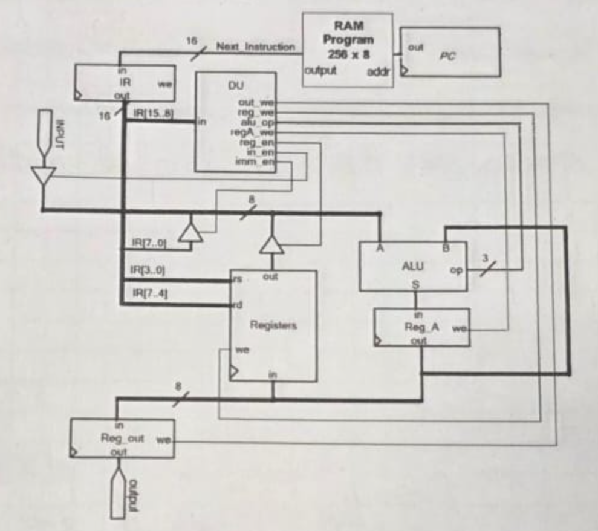
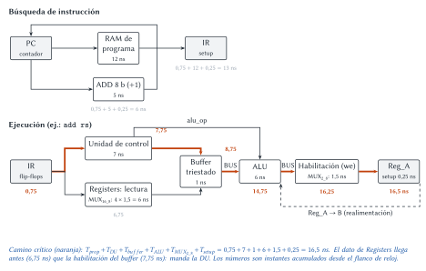
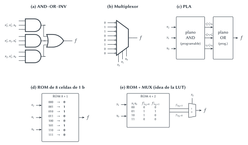
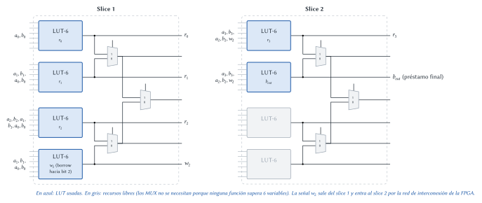
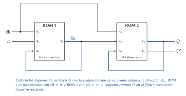

# Diseño Lógico — Final 20/02/2026 (resuelto)

Cada ejercicio tiene el mismo formato: el **enunciado**, la **idea** para encararlo, la
**resolución** paso a paso y, al final, **dónde está en el apunte** la teoría que se usa.

## Ejercicio 1 — Procesador: latches vs. flip-flops y tiempo de ciclo

> **Enunciado.** Dada una versión del procesador de la cátedra: (1) ¿cuáles de sus componentes
> secuenciales pueden implementarse con _latches_ en lugar de _flip-flops_? Justificar. (2) Con
> $T_{RAM} = 12$ ns, $T_{MUX_{2\_8}} = 1{,}5$ ns, $T_{DMUX_{2\_1}} = 1{,}5$ ns, $T_{DU} = 7$ ns,
> $T_{ADD_{8b}} = 5$ ns, $T_{ALU} = 6$ ns, $T_{\text{compuertas } 8b} = 1$ ns,
> $T_{\text{buffer}} = 1$ ns, $T_{setup} = 0{,}25$ ns, $T_{prop} = 0{,}75$ ns y
> $T_{hold} = 0{,}01$ ns, determinar el tiempo de estabilización del circuito y la frecuencia de
> operación.

**Qué hay en la figura.** PC y RAM de programa (la RAM devuelve la instrucción de 16 b, `Next_Instruction`),
IR, unidad de control (DU), banco `Registers` (16 registros de 8 b, direcciones `rs` = IR[3..0] y
`rd` = IR[7..4]), ALU, `Reg_A`, `Reg_out` y tres buffers triestado que mandan datos al BUS de 8 b:
`INPUT` (`in_en`), el inmediato IR[7..0] (`imm_en`) y la salida de `Registers` (`reg_en`).
Dos conexiones son clave: el BUS entra a la entrada **A** de la ALU, la entrada **B** viene de
`Reg_A`, y la salida **S** de la ALU vuelve a `Reg_A`. Es decir, $Reg\_A \leftarrow Reg\_A \text{ op } BUS$
(`Reg_A` es un acumulador). `Registers` y `Reg_out` se cargan desde `Reg_A`.

### 1.1 ¿Qué registros pueden ser latches?

**Idea.** Un latch es _transparente_ durante todo el nivel activo del reloj: mientras está
abierto, cualquier cambio en su entrada pasa a la salida. Eso es un problema **solo** si la
entrada del registro depende (a través de lógica combinacional) de su **propia salida**: el
valor daría varias vueltas por el lazo en un mismo semiciclo. Alcanza con que **un** flip-flop
rompa el lazo para que el resto pueda ser latch.

La regla práctica del apunte: _si el registro destino es también operando de la lógica que lo
alimenta ($R_i = F(R_i, \dots)$), tiene que ser flip-flop._

| Componente | ¿Hay lazo desde su salida hasta su entrada? | ¿Latch? |
|---|---|:---:|
| **Reg_A** | Sí, directo: $Reg\_A \to B \to ALU \to S \to Reg\_A$. | No, flip-flop |
| **PC** | Sí: se incrementa ($PC^{+} = PC + 1$, lazo PC → sumador → PC). | No, flip-flop |
| **Registers** | El lazo $Registers \to BUS \to ALU \to Reg\_A \to Registers$ pasa por `Reg_A`, que es flip-flop: queda cortado. | Sí |
| **Reg_out** | No: solo copia `Reg_A` hacia el puerto `output`. | Sí |
| **IR** | No: su entrada es $RAM[PC]$ y nada de lo que sale del IR vuelve a la RAM (no hay saltos). | Sí |

> **Respuesta.** Pueden implementarse con latches **Registers**, **Reg_out** e **IR**, porque
> ninguno forma un lazo consigo mismo (el único camino de realimentación del banco pasa por
> `Reg_A`). **Reg_A** y **PC** deben ser flip-flops, porque realimentan su propia entrada
> ($Reg\_A = Reg\_A \text{ op } BUS$ y $PC = PC + 1$).

> **Ojo.** Para que los latches funcionen hay que cuidar la fase del reloj: el IR no debe estar
> abierto cuando el PC cambia (si no, "vería" la instrucción siguiente en el mismo ciclo) y
> `Registers` no debe estar abierto cuando `Reg_A` cambia. En la práctica se diseña todo con
> flip-flops del mismo flanco para tener una única disciplina de reloj; la pregunta apunta a que
> sepas justificar **cuándo es obligatorio** el flip-flop.

### 1.2 Tiempo de estabilización y frecuencia

**Idea.** Entre dos flancos de reloj, la señal tiene que salir de un registro ($T_{prop}$),
atravesar toda la lógica combinacional del camino más largo y llegar a la entrada del registro
destino al menos $T_{setup}$ antes del próximo flanco. Por eso:

$$T_{clk} \geq T_{prop} + T_{\text{camino combinacional más largo}} + T_{setup} \qquad f_{max} = \frac{1}{T_{clk}}$$

(Para el cálculo se supone que todos los registros son flip-flops del mismo flanco.)

**Paso 1: listar los caminos entre registros.**

1. **Búsqueda:** PC → RAM → IR, y PC → sumador (+1) → PC.
2. **Ejecución** (el peor caso es una instrucción con ALU, por ejemplo `add rs`):
   IR → DU y lectura de `Registers` → buffer triestado (`reg_en`) → BUS → ALU → `Reg_A`.
3. **Carga de destinos:** `Reg_A` → `Registers` y `Reg_A` → `Reg_out`.

**Paso 2: descomponer los bloques que no tienen tiempo dado.** `Registers` tiene 16 registros:

- La **lectura** (`rs` → `out`) es un $MUX_{16\_8}$ armado con $MUX_{2\_8}$: $\log_2 16 = 4$ niveles →
  $4 \times 1{,}5 = 6$ ns.
- La **habilitación de escritura** (`we`) de cada registro es un $MUX_{2\_8}$ delante de su
  entrada (mantener / cargar) → $1{,}5$ ns. Lo mismo vale para `Reg_A` y `Reg_out`.
- El **decodificador de escritura** que elige el registro `rd` es un $DMUX_{16\_1}$ armado con
  $DMUX_{2\_1}$: 4 niveles → $6$ ns. Se combina con `reg_we` de la DU con una compuerta (1 ns).

**Paso 3: sumar cada camino** (los tiempos son instantes acumulados desde el flanco):

| Camino | Cuenta | Total |
|---|---|---:|
| PC → +1 → PC | $0{,}75 + 5 + 0{,}25$ | 6 ns |
| PC → RAM → IR | $0{,}75 + 12 + 0{,}25$ | 13 ns |
| `Reg_A` → `Registers` / `Reg_out` (habilitación desde la DU) | $0{,}75 + 7 + 1 + 1{,}5 + 0{,}25$ | 10,5 ns |
| IR → DU → buffer (`imm_en`) → ALU → MUX de `Reg_A` | $0{,}75 + 7 + 1 + 6 + 1{,}5 + 0{,}25$ | 16,5 ns |
| **IR → DU (`reg_en`) → buffer → ALU → MUX de `Reg_A` → `Reg_A`** | $0{,}75 + 7 + 1 + 6 + 1{,}5 + 0{,}25$ | **16,5 ns** |

Detalle del camino crítico: a los 0,75 ns el IR ya tiene la instrucción. La lectura de `Registers`
(6 ns) termina a los 6,75 ns, pero el buffer triestado no deja pasar el dato hasta que la unidad
de control activa `reg_en` (7 ns → 7,75 ns). Por eso manda la **DU**, no el banco. Luego:
buffer (8,75) → ALU (14,75) → MUX de habilitación (`regA_we`) de `Reg_A` (16,25) → setup (16,5).
La entrada B de la ALU (`Reg_A`) está lista desde los 0,75 ns, así que no alarga el camino.

**Paso 4: verificar el _hold_.** El dato no puede cambiar antes de $T_{hold}$ después del flanco.
El camino más corto entre registros (`Reg_A` → B → ALU → `Reg_A`) demora al menos
$T_{prop} + T_{ALU} = 6{,}75$ ns $> 0{,}01$ ns, así que no hay violación de hold.

> **Respuesta.** Tiempo de estabilización (período mínimo):
> $T_{clk} = 16{,}5$ ns. Frecuencia máxima de operación:
> $f = \dfrac{1}{16{,}5 \text{ ns}} \approx 60{,}6$ MHz.

> **Dónde está en el apunte.**
> Latch vs. flip-flop y por qué un registro realimentado necesita flip-flop:
> [Circuitos secuenciales](../../../apuntes/17-circuitos-secuenciales-asincronicos-y-sincronicos.md),
> §3 _Latch vs. flip-flop_ y §7 _Registros de datos y la necesidad de usar flip-flops_; también
> [Registros](../../../apuntes/20-registros.md), §6.
> Setup, hold y propagación: mismo apunte, §8 _Tiempos característicos de un flip-flop_.
> Camino crítico: [Circuitos lógicos combinacionales](../../../apuntes/09-circuitos-logicos-combinacionales.md), §4.
> Habilitación de escritura con MUX y banco de registros: [Registros](../../../apuntes/20-registros.md), §2.2 y §5.

## Ejercicio 2 — Técnicas de síntesis

> **Enunciado.** Mencionar y explicar las técnicas de síntesis vistas en el curso.

**Idea.** _Sintetizar_ es pasar de una descripción abstracta (tabla de verdad, ecuación, VHDL) a
un circuito. En el curso se vieron **cinco técnicas** para circuitos combinacionales. Lo más claro
es mostrarlas todas con la **misma función**, la del apunte:

$$f(x_2,x_1,x_0) = x_2'x_1'x_0 + x_2'x_1x_0' + x_2x_1'x_0 = \textstyle\sum m(1, 2, 5)$$

1. **Compuertas AND–OR–INV.** Una AND por cada minterm (con inversores para las variables
   negadas) y una OR que las suma. Es la forma canónica; se puede achicar minimizando antes
   (Karnaugh, Quine–McCluskey).
2. **Multiplexores.** Un $MUX_{2^n\_1}$ con las $n$ variables en la selección; cada entrada de
   datos se conecta a la constante 0 o 1 que dice la tabla de verdad en esa fila. No hace falta
   simplificar nada.
3. **PLA.** Un plano AND programable genera los términos producto y un plano OR programable los
   suma. Su ventaja: los términos producto se **comparten** entre varias salidas.
4. **ROM.** Es un PLA con el plano AND **fijo** (un decodificador que genera los $2^n$ minterms) y
   el plano OR programable. Se graba la tabla de verdad: dirección = entradas, contenido =
   salidas. Crece como $2^n$.
5. **ROM + MUX.** Se separa una variable (por ejemplo $x_2$) como selección de un MUX y el resto
   direcciona ROMs más chicas con los **cofactores** $f|_{x_2=0}$ y $f|_{x_2=1}$ (expansión de
   Shannon). Es la estructura de las **LUT y _slices_ de FPGA**.

> **Respuesta.** Las técnicas son: (1) AND–OR–INV, (2) multiplexores, (3) PLA, (4) ROM y (5)
> ROM + MUX, cuya aplicación concreta son los dispositivos de lógica programable FPGA (LUT de 6
> entradas + multiplexores dentro de un _slice_).

> **Dónde está en el apunte.** [Implementación](../../../apuntes/10-implementacion.md), §2
> _Técnicas de síntesis de circuitos combinacionales_ (§2.1 a §2.5) y §3 _Comparación de las
> técnicas_. Presentación _Síntesis lógica_, diapositivas 13 a 32.

## Ejercicio 3 — Restador de 4 b con _slices_ de FPGA

> **Enunciado.** Sintetizar un restador de números naturales de 4 b utilizando _slices_ de FPGA
> vistos. Especificar el contenido de las LUT.

**Idea.** El _slice_ simplificado tiene **4 LUT-6** (cada una es una ROM de $64 \times 1$, o sea,
cualquier función de **hasta 6 variables**) y 3 multiplexores que permiten combinar LUT para
funciones de 7 u 8 variables. El trabajo es:

1. Escribir cada bit de salida como función de sus entradas.
2. Contar variables: si son 6 o menos, entra en **una** LUT.
3. Si alguna función tiene demasiadas variables, partirla usando una señal intermedia.

**Paso 1: las funciones.** Restar $r = a - b$ con $a, b$ naturales de 4 b da 4 bits de resultado
y un **préstamo** (_borrow_) final $b_{out}$, que vale 1 cuando $a < b$ (el resultado "no entra"
en los naturales). Columna por columna, igual que el restador completo:

$$r_i = a_i \oplus b_i \oplus w_i \qquad w_{i+1} = a_i' b_i + (a_i \oplus b_i)'\, w_i \qquad w_0 = 0$$

donde $w_i$ es el préstamo que llega a la columna $i$.

**Paso 2: contar variables.**

| Salida | Depende de | Variables |
|---|---|:---:|
| $r_0$ | $a_0, b_0$ | 2 |
| $r_1$ | $a_1, b_1, a_0, b_0$ | 4 |
| $r_2$ | $a_2, b_2, a_1, b_1, a_0, b_0$ | 6 |
| $r_3$ | los 8 bits | 8: no entra |
| $b_{out}$ | los 8 bits | 8: no entra |

$r_3$ y $b_{out}$ necesitarían un slice entero cada uno (8 variables = 4 LUT + 3 MUX). Es más
barato **generar el préstamo intermedio** $w_2$ (préstamo hacia la columna 2), que depende solo de
$a_1, b_1, a_0, b_0$. Con él, $r_3$ y $b_{out}$ dependen de $a_3, b_3, a_2, b_2, w_2$: **5
variables**, entran en una LUT cada una.

**Paso 3: asignar LUT.** Seis LUT en dos slices; los MUX quedan sin usar.

**Paso 4: contenido de las LUT.** Cada LUT guarda la tabla de verdad de su función: en la
dirección formada por sus entradas se graba el valor de la salida. Las entradas que una función no
usa se dejan fijas en 0 (o la tabla se repite, porque no influyen).

- **LUT $r_0$** (entradas $b_0 a_0$): $r_0 = a_0 \oplus b_0$.

  | $b_0\,a_0$ | 00 | 01 | 10 | 11 |
  |---|:---:|:---:|:---:|:---:|
  | $r_0$ | 0 | 1 | 1 | 0 |

- **LUT $w_2$** (préstamo hacia la columna 2): vale 1 cuando $a_1a_0 < b_1b_0$.

  | $a_1a_0 \backslash b_1b_0$ | 00 | 01 | 10 | 11 |
  |:---:|:---:|:---:|:---:|:---:|
  | **00** | 0 | 1 | 1 | 1 |
  | **01** | 0 | 0 | 1 | 1 |
  | **10** | 0 | 0 | 0 | 1 |
  | **11** | 0 | 0 | 0 | 0 |

- **LUT $r_1$**: $r_1 = a_1 \oplus b_1 \oplus w_1$, con $w_1 = a_0' b_0$ (préstamo de la columna
  0). Es decir, la tabla de $a_1 \oplus b_1$, invertida en las filas donde $a_0 = 0$ y $b_0 = 1$.
- **LUT $r_2$**: $r_2 = a_2 \oplus b_2 \oplus w_2(a_1,b_1,a_0,b_0)$: las 64 filas se obtienen
  calculando $w_2$ con la tabla de arriba y haciendo XOR con $a_2$ y $b_2$.
- **LUT $r_3$** (slice 2): $r_3 = a_3 \oplus b_3 \oplus w_3$, con
  $w_3 = a_2' b_2 + (a_2 \oplus b_2)'\, w_2$.
- **LUT $b_{out}$** (slice 2): $b_{out} = a_3' b_3 + (a_3 \oplus b_3)'\, w_3$.

Si se quiere el contenido exacto de las 64 celdas, se escribe en hexadecimal (el bit $k$ del
número es la celda de dirección $k$). Con el orden de entradas $I_5 \dots I_0$ indicado:

| LUT | Entradas $I_5\,I_4\,I_3\,I_2\,I_1\,I_0$ | Contenido (64 b, hex) |
|---|---|---|
| $r_0$ | – – – – $b_0$ $a_0$ | `6666666666666666` |
| $r_1$ | – – $b_1$ $a_1$ $b_0$ $a_0$ | `4BB44BB44BB44BB4` |
| $r_2$ | $b_2$ $a_2$ $b_1$ $a_1$ $b_0$ $a_0$ | `4F04B0FBB0FB4F04` |
| $w_2$ | – – $b_1$ $a_1$ $b_0$ $a_0$ | `4F044F044F044F04` |
| $r_3$ | – $w_2$ $b_3$ $a_3$ $b_2$ $a_2$ | `D22D4BB4D22D4BB4` |
| $b_{out}$ | – $w_2$ $b_3$ $a_3$ $b_2$ $a_2$ | `DF0D4F04DF0D4F04` |

**Verificación rápida.** $a = 0101_2 = 5$, $b = 0011_2 = 3$: $w_1 = a_0'b_0 = 0$,
$r_0 = 1 \oplus 1 = 0$, $r_1 = 0 \oplus 1 \oplus 0 = 1$, $w_2 = (01 < 11) = 1$,
$r_2 = 1 \oplus 0 \oplus 1 = 0$, $w_3 = a_2'b_2 + (a_2 \oplus b_2)'w_2 = 0 + 0 = 0$,
$r_3 = 0$, $b_{out} = 0$ → $r = 0010_2 = 2$, que es $5 - 3$.

> **Respuesta.** Se usan 6 LUT en 2 slices: slice 1 → $r_0$, $r_1$, $r_2$ y el préstamo
> intermedio $w_2$; slice 2 → $r_3$ y $b_{out}$. Ninguna función pasa de 6 variables, así que los
> MUX de los slices no se usan. Cada LUT contiene la tabla de verdad de su función (tablas y
> contenido hexadecimal arriba).

> **Ojo.** La versión "directa" (cada salida en función de las 8 entradas) también es correcta,
> pero gasta un slice entero para $r_3$ y otro para $b_{out}$. Usar una señal intermedia es la
> misma idea que el acarreo encadenado de un sumador.

> **Dónde está en el apunte.** Slice y LUT: [Implementación](../../../apuntes/10-implementacion.md),
> §2.5 _ROM + MUX (y su relación con las LUT de FPGA)_, y
> [Lógica programable](../../../apuntes/23-logica-programable.md), §4 _FPGA_. Restador completo y
> préstamo: [Sumadores, restadores y comparadores](../../../apuntes/16-sumadores-restadores-y-comparadores.md),
> §5.1. Presentación _Síntesis lógica_, diapositivas 30 a 32 (dibujo del slice).

## Ejercicio 4 — Flip-flop D con ROMs de 8 celdas de 4 b

> **Enunciado.** Sintetizar un _flip-flop D_ utilizando ROMs de 8 celdas de 4 b (se puede usar más
> de una ROM).

**Idea.** Una ROM es combinacional: no recuerda nada. Para que haya memoria hay que **realimentar**
una salida a una dirección, igual que en el latch hecho con compuertas. El camino es:

1. Armar un **latch D** con una ROM.
2. Armar el **flip-flop D** con dos latches en configuración **maestro–esclavo**.

**Paso 1: latch D en una ROM.** El latch D con habilitación $E$ cumple:
$Q^{+} = E \cdot D + E' \cdot Q$ (si $E = 1$ copia $D$; si $E = 0$ mantiene). Tiene 3 variables
($E$, $D$, $Q$) y una ROM de 8 celdas tiene exactamente 3 bits de dirección. Se usa el bit $D_0$
de la palabra como $Q^{+}$ y el bit $D_1$ como $Q'^{+}$ (los otros dos bits quedan en 0).

**Paso 2: maestro–esclavo.** El maestro es transparente cuando $clk = 0$ y el esclavo cuando
$clk = 1$. Así, en el flanco ascendente el maestro se "cierra" con el valor de $D$ y el esclavo lo
copia a la salida: el conjunto solo cambia en el flanco.

**Paso 3: contenido de las ROM.** Dirección $A_2A_1A_0$.

| $A_2$ | $A_1$ | $A_0$ | ROM 1 (maestro): $A_2 = clk$, $A_1 = D$, $A_0 = Q_m$ → $Q_m^{+} = clk' D + clk\, Q_m$ | ROM 2 (esclavo): $A_2 = clk$, $A_1 = Q_m$, $A_0 = Q$ → $Q^{+} = clk\, Q_m + clk' Q$ |
|:---:|:---:|:---:|:---:|:---:|
| 0 | 0 | 0 | 0 (copia $D=0$) | 0 (mantiene) |
| 0 | 0 | 1 | 0 (copia $D=0$) | 1 (mantiene) |
| 0 | 1 | 0 | 1 (copia $D=1$) | 0 (mantiene) |
| 0 | 1 | 1 | 1 (copia $D=1$) | 1 (mantiene) |
| 1 | 0 | 0 | 0 (mantiene) | 0 (copia $Q_m=0$) |
| 1 | 0 | 1 | 1 (mantiene) | 0 (copia $Q_m=0$) |
| 1 | 1 | 0 | 0 (mantiene) | 1 (copia $Q_m=1$) |
| 1 | 1 | 1 | 1 (mantiene) | 1 (copia $Q_m=1$) |

Escrito como palabras de 4 b ($D_3D_2D_1D_0$, con $D_1$ igual al complemento de $D_0$):

| Dirección | 0 | 1 | 2 | 3 | 4 | 5 | 6 | 7 |
|---|---|---|---|---|---|---|---|---|
| ROM 1 | 0010 | 0010 | 0001 | 0001 | 0010 | 0001 | 0010 | 0001 |
| ROM 2 | 0010 | 0001 | 0010 | 0001 | 0010 | 0010 | 0001 | 0001 |

**Comprobación.** Con $clk = 0$ el maestro sigue a $D$ y el esclavo mantiene $Q$. Cuando $clk$
sube a 1, el maestro pasa a "mantener" (se queda con el último $D$) y el esclavo copia $Q_m$: la
salida toma el valor que tenía $D$ justo en el flanco ascendente. Mientras $clk = 1$, aunque $D$
cambie, el maestro no lo deja pasar.

> **Respuesta.** Dos ROM de $8 \times 4$: cada una implementa un latch D realimentando su salida
> $D_0$ a la dirección $A_0$; la primera (maestro) habilitada con $clk'$ y la segunda (esclavo)
> con $clk$. El contenido es el de las tablas anteriores.

> **Dónde está en el apunte.** Latch D y su tabla:
> [Circuitos secuenciales](../../../apuntes/17-circuitos-secuenciales-asincronicos-y-sincronicos.md),
> §2.3 _Latch D síncrono_; maestro–esclavo: §4 _Configuración maestro-esclavo: construcción del
> flip-flop D_. ROM como tabla de verdad: [Implementación](../../../apuntes/10-implementacion.md),
> §2.4, y [Memoria](../../../apuntes/21-memoria.md), §4.
