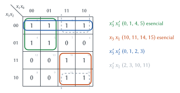
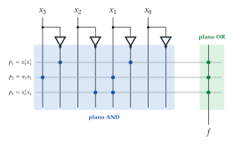
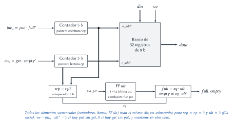

# Diseño Lógico — Parcial 2016 (resuelto)

Cada ejercicio tiene el mismo formato: el **enunciado**, la **idea** para encararlo, la
**resolución** paso a paso y, al final, **dónde está en el apunte** la teoría que se usa.

## Ejercicio 1 — Minimización de $f = \sum m(0, 1, 2, 3, 4, 5, 10, 11, 14, 15)$

> **Enunciado.** Dada $f_1 = \sum m(0, 1, 2, 3, 4, 5, 10, 11, 14, 15)$: (1) minimizar por Karnaugh;
> (2) identificar implicantes primos y esenciales; (3) resolver por Quine–McCluskey; (4)
> sintetizar en un PLA.

Variables $x_3x_2x_1x_0$ (el minterm $m_i$ es $i$ en binario).

### 1.1 Karnaugh

**Idea.** Mapa en orden de Gray, poner los unos y cubrirlos con los rectángulos (1, 2, 4, 8
casillas) **más grandes** posibles, usando los menos rectángulos posibles.



- **Verde, $x_3'x_1'$** (0, 1, 4, 5): filas 00–01, columnas 00–01.
- **Naranja, $x_3x_1$** (10, 11, 14, 15): filas 11–10, columnas 11–10.
- Quedan sin cubrir el 2 y el 3. Hay **dos** grupos de 4 que los cubren:
  - **Azul, $x_3'x_2'$** (0, 1, 2, 3): la fila 00 completa.
  - **Gris, $x_2'x_1$** (2, 3, 10, 11): filas 00 y 10 (vecinas por el borde), columnas 11–10.

> **Respuesta.** Hay dos soluciones mínimas, igual de buenas (3 términos de 2 literales):
> $f = x_3'x_1' + x_3x_1 + x_3'x_2'$ o $f = x_3'x_1' + x_3x_1 + x_2'x_1$.

### 1.2 Implicantes primos y esenciales

> **Respuesta.**
> **Implicantes primos** (grupos que no se pueden agrandar más): $x_3'x_1'$, $x_3x_1$, $x_3'x_2'$ y
> $x_2'x_1$.
> **Esenciales** (cubren algún 1 que ningún otro primo cubre): $x_3'x_1'$ (es el único que cubre
> 4 y 5) y $x_3x_1$ (único que cubre 14 y 15). $x_3'x_2'$ y $x_2'x_1$ no son esenciales: los dos
> cubren 2 y 3, así que alcanza con uno de ellos.

### 1.3 Quine–McCluskey

**Idea.** Es lo mismo que Karnaugh, pero en tablas: (a) agrupar los minterms por cantidad de unos;
(b) combinar términos de grupos vecinos que difieran en **un solo** bit (ese bit pasa a `-`);
repetir hasta que no se pueda; (c) lo que no se combinó son los implicantes primos; (d) tabla de
cobertura para elegir.

**Paso 1: agrupar por cantidad de unos.**

| Unos | Minterms |
|:---:|---|
| 0 | 0 (0000) |
| 1 | 1 (0001), 2 (0010), 4 (0100) |
| 2 | 3 (0011), 5 (0101), 10 (1010) |
| 3 | 11 (1011), 14 (1110) |
| 4 | 15 (1111) |

**Paso 2: combinar de a pares** (todos los minterms se combinan con alguno):

| Par | Término | Par | Término |
|---|:---:|---|:---:|
| 0, 1 | `000-` | 2, 10 | `-010` |
| 0, 2 | `00-0` | 3, 11 | `-011` |
| 0, 4 | `0-00` | 10, 11 | `101-` |
| 1, 3 | `00-1` | 10, 14 | `1-10` |
| 1, 5 | `0-01` | 11, 15 | `1-11` |
| 2, 3 | `001-` | 14, 15 | `111-` |
| 4, 5 | `010-` | | |

**Paso 3: combinar de a cuatro** (los `-` tienen que estar en la misma posición):

| Grupo | Término | Producto |
|---|:---:|:---:|
| 0, 1, 2, 3 | `00--` | $x_3'x_2'$ |
| 0, 1, 4, 5 | `0-0-` | $x_3'x_1'$ |
| 2, 3, 10, 11 | `-01-` | $x_2'x_1$ |
| 10, 11, 14, 15 | `1-1-` | $x_3x_1$ |

Todos los pares se usaron en algún grupo de cuatro y los grupos de cuatro no se pueden combinar
entre sí: **estos 4 son los implicantes primos.**

**Paso 4: tabla de cobertura** (× = el primo cubre ese minterm):

| Primo | 0 | 1 | 2 | 3 | 4 | 5 | 10 | 11 | 14 | 15 |
|---|:---:|:---:|:---:|:---:|:---:|:---:|:---:|:---:|:---:|:---:|
| $x_3'x_2'$ | × | × | × | × | | | | | | |
| $x_3'x_1'$ | × | × | | | **×** | **×** | | | | |
| $x_2'x_1$ | | | × | × | | | × | × | | |
| $x_3x_1$ | | | | | | | × | × | **×** | **×** |

Las columnas 4, 5, 14 y 15 tienen una sola × → $x_3'x_1'$ y $x_3x_1$ son **esenciales**. Con ellos
quedan sin cubrir 2 y 3, que se cubren con $x_3'x_2'$ **o** con $x_2'x_1$.

> **Respuesta.** Mismo resultado que con Karnaugh: $f = x_3'x_1' + x_3x_1 + x_3'x_2'$ (o con
> $x_2'x_1$ en lugar del último término).

### 1.4 PLA

**Idea.** Un término producto por cada implicante elegido en el plano AND y una salida en el
plano OR que los suma. Se elige $f = x_3'x_1' + x_3x_1 + x_2'x_1$.



| Producto | $x_3$ | $x_2$ | $x_1$ | $x_0$ | $f$ |
|---|:---:|:---:|:---:|:---:|:---:|
| $p_1 = x_3'x_1'$ | 01 | 00 | 01 | 00 | 1 |
| $p_2 = x_3x_1$ | 10 | 00 | 10 | 00 | 1 |
| $p_3 = x_2'x_1$ | 00 | 01 | 10 | 00 | 1 |

(`10` = variable directa, `01` = negada, `00` = no participa.)

> **Dónde está en el apunte.** Karnaugh: [Redundancias](../../../apuntes/08-redundancias.md), §3
> (§3.3 reglas de agrupamiento, §3.5 ejemplo de 4 variables) y §5 (métodos tabulares). Minterms:
> [Formas canónicas](../../../apuntes/07-formas-canonicas.md), §4. PLA:
> [Implementación](../../../apuntes/10-implementacion.md), §2.3. Presentación _Síntesis lógica_,
> diapositivas 33 a 41.

## Ejercicio 2 — Fila circular (FIFO) de $32 \times 8$

> **Enunciado.** Implementar en hardware una fila circular (FIFO) de 32 elementos de 8 b con un
> banco de registros y lógica adicional. Entradas: $clk$, $rst$ (asincrónico), $din$, $put$ y $get$.
> Salidas: $dout$ (el dato más antiguo), $empty$ y $full$. Las escrituras son ascendentes desde la
> dirección 0 y se pueden usar hasta 2 contadores de 5 b.

**Idea.** Una fila circular sobre un banco de 32 registros se maneja con **dos punteros**:

- $wp$ (_write pointer_): dónde se escribe el próximo dato. Contador de 5 b.
- $rp$ (_read pointer_): dónde está el dato más antiguo. Contador de 5 b.

Al llegar a 31 los contadores vuelven solos a 0 (son de 5 b): eso hace la fila **circular**.

**Funcionamiento.**

1. **Escribir ($put$):** si la fila no está llena, se escribe $din$ en el registro $wp$
   ($w\_addr = wp$, $we = put \cdot full'$) y se incrementa $wp$.
2. **Leer ($get$):** $dout$ siempre muestra el registro $rp$ ($r\_addr = rp$); al hacer $get$ (si
   no está vacía) se incrementa $rp$ y pasa a mostrarse el siguiente.
3. **Vacía / llena:** en los dos casos los punteros son **iguales** ($wp = rp$): al principio
   ninguno avanzó (vacía) y después de 32 escrituras sin lecturas $wp$ dio la vuelta y alcanzó a
   $rp$ (llena). Con solo dos contadores, para distinguirlos se agrega **un flip-flop** $ult$ que
   recuerda si la última operación que cambió la cantidad fue un $put$ (1) o un $get$ (0):

$$eq = (wp = rp) \qquad full = eq \cdot ult \qquad empty = eq \cdot ult'$$

$ult^+ = 1$ si $put \cdot get'$; $ult^+ = 0$ si $get \cdot put'$; si no, mantiene. Con $put$ y
$get$ a la vez (y la fila ni vacía ni llena) avanzan los dos punteros y la cantidad no cambia.



**Detalle de cada bloque.**

- **Banco de registros $32 \times 8$:** como el del [parcial 2017](parcial-2017-resuelto.md)
  (Ejercicio 1), con $DMUX_{32\_1}$ para la escritura y $MUX_{32\_8}$ para la lectura.
- **Contadores:** contador de 5 b con habilitación ($inc$) y reset asincrónico; con $inc = 0$
  mantienen (habilitación en la línea de datos, no en el reloj).
- **Comparador de igualdad de 5 b:** $eq = \prod_{i=0}^{4} (wp_i \odot rp_i)$ (5 XNOR y una AND).
- **Reset:** $wp = rp = 0$ y $ult = 0$ → arranca **vacía**.

> **Respuesta.** Banco de $32 \times 8$ con $w\_addr = wp$ y $r\_addr = rp$; dos contadores de 5 b
> (punteros) que se incrementan con $put \cdot full'$ y $get \cdot empty'$; un comparador
> $wp = rp$ y un flip-flop que recuerda la última operación para distinguir vacía de llena.

> **Ojo.** Sin el flip-flop extra (y sin más contadores) no se puede distinguir vacía de llena:
> en ambos casos $wp = rp$. Otra opción clásica es usar punteros de 6 b, pero el enunciado limita
> a contadores de 5 b.

> **Dónde está en el apunte.** [Registros](../../../apuntes/20-registros.md), §2 (habilitación) y
> §5 (banco de registros). [Circuitos contadores](../../../apuntes/19-circuitos-contadores.md), §5
> (contador con habilitación, módulo $n$). Comparador:
> [Sumadores, restadores y comparadores](../../../apuntes/16-sumadores-restadores-y-comparadores.md), §6.

## Ejercicio 3 — Punto flotante IBM 360

> **Enunciado.** Dadas las representaciones IBM 360 `4D23D70A` y `519E0F26`, realizar (1) la suma y
> (2) la multiplicación.

> **Supuesto.** Este formato no está en los apuntes del repositorio. Se usa el formato estándar de
> simple precisión de IBM System/360.

**El formato (32 b).** $\underbrace{S}_{1\text{ b}}\ \underbrace{E}_{7\text{ b}}\ \underbrace{F}_{24\text{ b} = 6 \text{ hex}}$
con valor

$$N = (-1)^S \cdot 0.F_{16} \cdot 16^{E - 64}$$

Diferencias con IEEE 754: la base del exponente es **16** (no 2), el exponente tiene exceso **64**,
la mantisa es una **fracción** $0.F$ sin bit oculto, y está normalizada cuando su **primer dígito
hexadecimal** es distinto de 0. El hardware **trunca** (no redondea).

**Decodificación.**

| | Hex | Primer byte en binario | $S$ | $E$ | $E - 64$ | Mantisa |
|---|---|---|:---:|:---:|:---:|---|
| $A$ | `4D23D70A` | `0 1001101` | 0 | 77 | 13 | $0.23D70A_{16}$ |
| $B$ | `519E0F26` | `0 1010001` | 0 | 81 | 17 | $0.9E0F26_{16}$ |

$A = 0.23D70A \times 16^{13} \approx 6{,}305 \times 10^{14}$ y
$B = 0.9E0F26 \times 16^{17} \approx 1{,}8223 \times 10^{20}$.

### 3.1 Suma

**Paso 1: igualar exponentes.** Se lleva el menor al mayor: $17 - 13 = 4$ → la mantisa de $A$ se
corre **4 dígitos hex** a la derecha (cada dígito hex es un factor 16):
$0.23D70A \times 16^{13} = 0.000023\,|\,D70A \times 16^{17}$. Los dígitos que no entran en los 6
se pierden (truncamiento).

**Paso 2: sumar mantisas** (en hexadecimal):

```text
    0.9E0F26
  + 0.000023
  ----------
    0.9E0F49
```

**Paso 3: normalizar.** El primer dígito es 9 (≠ 0) y no hubo acarreo: ya está normalizado. El
exponente queda 17 → $E = 81 = 51_{16}$.

> **Respuesta.** $A + B$ = `519E0F49` $\approx 1{,}82230436 \times 10^{20}$. (El valor exacto sería
> $\approx 1{,}82230451 \times 10^{20}$: la diferencia es lo que se perdió al truncar `D70A`.)

### 3.2 Multiplicación

**Paso 1: signo.** $0 \oplus 0 = 0$ (positivo).

**Paso 2: exponentes.** Se **suman los exponentes reales**: $13 + 17 = 30$ → con exceso 64,
$E = 94 = 5E_{16}$ (equivalente: $77 + 81 - 64$).

**Paso 3: mantisas.** $0.23D70A \times 0.9E0F26 = 0.1620D717817C_{16}$ (producto de 12 dígitos).

**Paso 4: normalizar y truncar.** El primer dígito es 1 (≠ 0): está normalizado. Se conservan 6
dígitos: $0.1620D7$.

**Paso 5: armar.** $S = 0$, $E = 1011110$ → primer byte `0101 1110` = `5E`.

> **Respuesta.** $A \times B$ = `5E1620D7` $\approx 1{,}149 \times 10^{35}$.

> **Dónde está en el apunte.** La idea de punto flotante (signo, exponente con sesgo, mantisa) está
> en [Representación de números](../../../apuntes/03-representacion-de-numeros-enteros-fraccionarios-y-negativos.md),
> §6 (IEEE 754); IBM 360 aplica la misma idea con base 16. Conversión binario ↔ hexadecimal:
> [Repaso de sistemas numéricos](../../../apuntes/02-repaso-de-sistemas-numericos.md), §3.3.

## Ejercicio 4 — Preguntas

> **Enunciado.** (1) Diferencias entre _latch_ y _flip-flop_. (2) Definir síntesis lógica. (3) ¿Tiene
> sentido un _latch T_? (4) ¿Para qué aplicaciones se usaría la representación en CB? (5) Ejemplos:
> (a) resta en CB(10, 2) que genere _overflow_ y _carry_; (b) suma en CB(2, 8) que genere _carry_ y
> no _overflow_. (6) Representar en IEEE 754 de 32 b: (a) $9 \cdot 10^{-42}$; (b) $234{,}745$.

### 4.1 Latch vs. flip-flop

> **Respuesta.** El **latch** es sensible al **nivel** de la señal de habilitación (transparente
> mientras está activa); el **flip-flop** es sensible al **flanco** (captura solo en el instante del
> flanco activo). El flip-flop se arma con dos latches en maestro–esclavo, por lo que ocupa el
> doble de área. Se necesita flip-flop cuando la entrada del registro depende de su propia salida.

### 4.2 Síntesis lógica

> **Respuesta.** Proceso por el cual se obtiene un circuito en términos de compuertas lógicas a
> partir de una descripción abstracta (tabla de verdad, ecuación, VHDL/Verilog). Es pasar de un
> nivel de abstracción a uno inferior, en forma manual o automática.

### 4.3 ¿Tiene sentido un latch T?

> **Respuesta.** **No.** Un elemento T con $T = 1$ debe **conmutar una vez**: $Q^+ = Q'$. En un
> latch, mientras la habilitación está activa el circuito es transparente: la salida invertida
> vuelve a entrar inmediatamente, vuelve a invertirse, y así sucesivamente. El latch **oscila**
> durante todo el nivel activo y el valor final depende de la duración del pulso y de los
> retardos: es impredecible. Conmutar exactamente una vez requiere sensibilidad al **flanco**, por
> eso solo existe el **flip-flop** T.

### 4.4 ¿Cuándo usar CB?

> **Respuesta.** Para aritmética con enteros con signo (procesadores, ALU): con el complemento a
> la base la resta se hace con el mismo sumador (sumando el complemento), el acarreo final se
> descarta, hay un único cero y el desborde se detecta fácil.

### 4.5 Ejemplos en CB

**Recordatorio.** **Carry** es el acarreo que sale del dígito más significativo. **Overflow** es que
el resultado no entra en el rango (se detecta porque dos operandos del mismo signo dan un resultado
de signo contrario). Son cosas distintas.

**(a) Resta en CB(10, 2) con overflow y carry.** Base 10, 2 dígitos: 100 representaciones; rango
$-50 \dots 49$ (00–49 positivos, 50–99 negativos, valor $= R - 100$).

Se calcula $(-40) - 30$, que da $-70$ (fuera de rango):

- $-40 \to 100 - 40 = 60$.
- Restar 30 es sumar su complemento: $100 - 30 = 70$.

```text
    6 0
  + 7 0
  -----
  1 3 0   → carry = 1; quedan 2 dígitos: 30 → se lee +30
```

Hay **carry** (sale un 1) y **overflow**: un negativo menos un positivo (= suma de dos negativos)
dio un resultado positivo (+30 en lugar de −70).

**(b) Suma en CB(2, 8) con carry y sin overflow.** Se calcula $(-3) + 5 = 2$:

```text
    1111 1101   (-3)
  + 0000 0101   (+5)
  -----------
  1 0000 0010   → carry = 1; resultado 0000 0010 = +2 (correcto)
```

Hay **carry**, pero **no overflow**: los operandos tienen signos distintos, y sumar un positivo y
un negativo nunca desborda.

### 4.6 IEEE 754 de 32 b

**(a) $9 \cdot 10^{-42}$.** El menor número **normalizado** es $2^{-126} \approx 1{,}18 \times 10^{-38}$.
$9 \cdot 10^{-42}$ es más chico: es un número **desnormalizado** (subnormal): exponente almacenado
$E = 0$ y valor $0.M \times 2^{-126} = M \times 2^{-149}$, donde $M$ es la mantisa leída como
entero.

1. $M = 9 \cdot 10^{-42} / 2^{-149} \approx 6422{,}6$ → se redondea a $M = 6423$.
2. $6423 = 1\,1001\,0001\,0111_2$; completado a 23 bits: `000 0000 0001 1001 0001 0111`.
3. $S = 0$, $E = 00000000$.

$$9 \cdot 10^{-42} \to \underbrace{0}_{S}\ \underbrace{00000000}_{E}\ \underbrace{00000000001100100010111}_{M} = \texttt{0x00001917}$$

El valor realmente representado es $6423 \cdot 2^{-149} \approx 9{,}0005 \times 10^{-42}$ (hay
error de representación).

**(b) $234{,}745$.**

1. Parte entera: $234 = 11101010_2$.
2. Parte fraccionaria, multiplicando por 2: $0{,}745 \to 1, 0, 1, 1, 1, 1, 1, 0, 1, 0, 1, 1, 1,
   0, 0, 0, 0, 1 \dots$ → $0{,}745 \approx 0{,}1011111010111000\,01\ldots_2$.
3. Normalizar: $11101010{,}1011111010111000\ldots = 1{,}1101010\,1011111010111000\ldots \times 2^7$.
4. $S = 0$; $E = 7 + 127 = 134 = 10000110_2$.
5. Mantisa (23 bits después del 1 oculto): $1101010$ (7 bits de la parte entera) +
   $1011111010111000$ (16 bits de la fracción) = `11010101011111010111000`. El bit siguiente es 0,
   así que no se redondea hacia arriba.

$$234{,}745 \to \underbrace{0}_{S}\ \underbrace{10000110}_{E}\ \underbrace{11010101011111010111000}_{M} = \texttt{0x436ABEB8}$$

(Valor representado: $234{,}7449951\ldots$; $0{,}745$ no tiene representación binaria finita.)

> **Dónde está en el apunte.** Latch/flip-flop y T:
> [Circuitos secuenciales](../../../apuntes/17-circuitos-secuenciales-asincronicos-y-sincronicos.md),
> §3, §4 y §6. Síntesis: [Implementación](../../../apuntes/10-implementacion.md), §1.1. Complemento,
> carry y overflow: [Representación de números](../../../apuntes/03-representacion-de-numeros-enteros-fraccionarios-y-negativos.md),
> §4.2–4.4. IEEE 754: mismo apunte, §6 (el caso desnormalizado no está en el apunte; se explica
> acá). Conversión de fracciones: [Repaso de sistemas numéricos](../../../apuntes/02-repaso-de-sistemas-numericos.md), §3.
