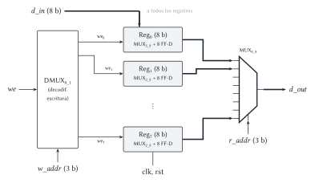
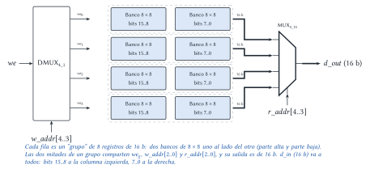
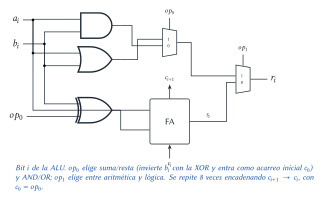

# Diseño Lógico — Parcial 2017 (resuelto)

Cada ejercicio tiene el mismo formato: el **enunciado**, la **idea** para encararlo, la
**resolución** paso a paso y, al final, **dónde está en el apunte** la teoría que se usa.

## Ejercicio 1 — Banco de registros

> **Enunciado.** Implementar un banco de 8 registros de 8 b a partir de registros de 8 b hechos con
> _flip-flop D_. Entradas: $clk$, $rst$ (reset asincrónico), $r\_addr$ (dirección de lectura),
> $w\_addr$ (dirección de escritura), $we$ (habilitación de escritura), $d\_in$ (dato a escribir);
> salida $d\_out$. (1) Implementar el banco de $8 \times 8$ b. (2) Implementar un banco de 32
> registros de 16 b a partir del banco anterior. (3) ¿Cómo se modela la habilitación de escritura
> de un registro?

### 1.1 Banco de $8 \times 8$

**Idea.** Un banco de registros tiene tres partes:

1. **Almacenamiento:** 8 registros de 8 b (cada uno, 8 flip-flops D con el mismo $clk$ y $rst$).
2. **Escritura:** $d\_in$ llega a **todos** los registros, pero solo debe cargarlo el que indica
   $w\_addr$, y solo si $we = 1$. Un $DMUX_{8\_1}$ con $we$ como dato y $w\_addr$ como selección
   genera $we_0 \dots we_7$: como mucho una vale 1.
3. **Lectura:** un $MUX_{8\_8}$ con $r\_addr$ en la selección elige qué registro sale por $d\_out$.

**Anchos.** 8 registros → direcciones de $\log_2 8 = 3$ b. $d\_in$ **no** se direcciona: va a
todos y la habilitación decide quién lo guarda.



### 1.2 Banco de $32 \times 16$ a partir de bancos de $8 \times 8$

**Idea.** Hay que ampliar en dos sentidos:

- **Ancho (8 → 16 b):** se ponen **dos bancos uno al lado del otro** con las mismas direcciones y
  la misma habilitación; uno guarda los bits 15..8 y el otro los 7..0. Juntos forman un "grupo" de
  8 registros de 16 b.
- **Cantidad (8 → 32 registros):** se necesitan $32 / 8 = 4$ grupos. La dirección pasa a tener
  $\log_2 32 = 5$ b: los 2 bits altos eligen el **grupo** y los 3 bajos el registro dentro del
  grupo.
  - Escritura: un $DMUX_{4\_1}$ reparte $we$ al grupo indicado por $w\_addr[4..3]$.
  - Lectura: un $MUX_{4\_16}$ con $r\_addr[4..3]$ elige la salida de 16 b de uno de los grupos.

Total: $4 \times 2 = 8$ **bancos** de $8 \times 8$.



### 1.3 Habilitación de escritura

> **Respuesta.** Con un **multiplexor en la línea de datos** de cada flip-flop:
> $D_i = we \cdot d\_in_i + we' \cdot Q_i$. Si $we = 0$ el flip-flop vuelve a cargar su propio
> valor (mantiene); si $we = 1$ carga el dato nuevo. El reloj llega siempre igual a todos. **No**
> se hace con una AND entre $clk$ y $we$: intervenir la línea de reloj genera problemas de
> sincronismo (retardos y pulsos espurios en el reloj).

> **Dónde está en el apunte.** [Registros](../../../apuntes/20-registros.md): §1 (PIPO), §2
> _Habilitación de escritura_ (§2.1 solución inválida con el reloj, §2.2 MUX en la línea de datos)
> y §5 _Banco de registros_ (con las preguntas de diseño: ancho de direcciones, si $d\_in$ se
> direcciona, cómo ampliar). DMUX y MUX:
> [Multiplexores y demultiplexores](../../../apuntes/15-multiplexores-y-demultiplexores.md).
> Ampliación (análoga a la de memorias): [Memoria](../../../apuntes/21-memoria.md), §5.2.

## Ejercicio 2 — ALU de 8 b

> **Enunciado.** ALU de 8 b con operandos $a$, $b$ y resultado $r$ de 8 b, y $op$ de 2 b:
> $op = 0$: $a + b$; $1$: $a - b$; $2$: $a$ AND $b$; $3$: $a$ OR $b$ (suma y resta en complemento a
> 2). Se dispone de $MUX_{2\_1}$, $DMUX_{2\_1}$, sumadores completos (FA) y compuertas AND, OR, XOR e
> INV.

**Idea.** Mirar los bits de $op$:

| $op$ | $op_1$ | $op_0$ | Operación |
|:---:|:---:|:---:|---|
| 0 | 0 | 0 | $a + b$ |
| 1 | 0 | 1 | $a - b$ |
| 2 | 1 | 0 | $a$ AND $b$ |
| 3 | 1 | 1 | $a$ OR $b$ |

- $op_1$ separa **aritmética** (0) de **lógica** (1) → un $MUX_{2\_1}$ por bit al final.
- Dentro de la aritmética, $op_0$ separa suma de resta. Con complemento a 2:
  $a - b = a + b' + 1$. Se usa el **sumador/restador**: una XOR por bit ($b_i \oplus op_0$ invierte
  $b$ cuando $op_0 = 1$) y el acarreo inicial $c_0 = op_0$ (suma el $+1$).
- Dentro de la lógica, $op_0$ elige AND (0) u OR (1) → otro $MUX_{2\_1}$.

**Por bit $i$:** 1 AND, 1 OR, 1 XOR, 1 FA y 2 $MUX_{2\_1}$:

$$r_i = op_1' \cdot s_i + op_1 \cdot \big(op_0' (a_i b_i) + op_0 (a_i + b_i)\big), \qquad s_i = a_i \oplus (b_i \oplus op_0) \oplus c_i$$



> **Respuesta.** 8 celdas iguales como la de la figura, con los FA encadenados ($c_{i+1} \to c_i$)
> y $c_0 = op_0$. Total: 8 FA, 8 XOR, 8 AND, 8 OR y 16 $MUX_{2\_1}$. Los $DMUX_{2\_1}$ no hacen
> falta.

> **Dónde está en el apunte.** [Sumadores, restadores y comparadores](../../../apuntes/16-sumadores-restadores-y-comparadores.md),
> §5.2 (resta con complemento a 2), §5.3 _Sumador/restador combinado_ (la XOR con $M$) y §7 _Hacia
> la ALU_. MUX: [Multiplexores y demultiplexores](../../../apuntes/15-multiplexores-y-demultiplexores.md), §1.1.

## Ejercicio 3 — Representación con complementos

> **Enunciado.** Representar y operar, indicando en decimal el resultado representado: (1) resta en
> CD(4, 4) con frontera $57_{10}$ entre $120_{10}$ y $-60_{10}$; (2) suma en CD(4, 4) con frontera
> 57 entre $120$ y $70$; (3) suma en CI(10, 3) entre $-120$ y $-70$; (4) suma en CI(10, 3) entre
> $-120$ y $-390$.

> **Supuesto.** Este tema **no está en los apuntes ni en las presentaciones del repositorio**, así
> que se usan las definiciones habituales, que conviene confirmar con la cátedra:
> la notación es (base $b$, cantidad de dígitos $n$); **CD** = complemento disminuido (a la base
> menos uno): un negativo $-x$ se representa como $(b^n - 1) - x$; **CI** = complemento a la base:
> $-x$ se representa como $b^n - x$. La **frontera** $F$ es el mayor positivo: las
> representaciones $0 \dots F$ son positivas y las de $F + 1 \dots b^n - 1$, negativas. En CI(10, 3)
> se toma la frontera usual, 499.

### 3.1 y 3.2 En CD(4, 4) con frontera 57

**Rango.** Base 4 con 4 dígitos: $4^4 = 256$ representaciones (0 a 255).

- Positivos: representación $0 \dots 57$ → valores $0 \dots 57$ ($57 = 0321_4$).
- Negativos: representación $R = 58 \dots 255$ → valor $-(255 - R)$, de $-197$ a $-0$.

**Representaciones** (en base 4 se complementa dígito a dígito con $3 - d$):

| Número | Cuenta | Base 4 | ¿Entra en el rango? |
|---|---|:---:|---|
| $120$ | $1 \cdot 64 + 3 \cdot 16 + 2 \cdot 4 + 0$ | $1320_4$ | **No**: $120 > 57$ (ese patrón se lee como $-135$) |
| $60$ | | $0330_4$ | sí |
| $-60$ | complemento de $0330$: $3003_4 = 195$ | $3003_4$ | sí |
| $70$ | | $1012_4$ | **No**: $70 > 57$ |

**(1) $120 - (-60)$.** Restar es sumar el complemento del sustraendo: el complemento de $3003_4$
es $0330_4$ ($= 60$).

```text
    1 3 2 0      (120)
  + 0 3 3 0      (60)
  ---------
    2 3 1 0      = 2·64 + 3·16 + 1·4 + 0 = 180   (sin acarreo final)
```

$180 > 57$ → la representación es negativa: vale $-(255 - 180) = -75$. **Resultado representado:
$-75$.** El resultado real (180) no entra en el rango: hay **desborde**.

**(2) $120 + 70$.**

```text
    1 3 2 0      (120)
  + 1 0 1 2      (70)
  ---------
    2 3 3 2      = 128 + 48 + 12 + 2 = 190
```

$190 > 57$ → vale $-(255 - 190) = -65$. **Resultado representado: $-65$**, de nuevo con desborde
(el real es 190).

> **Respuesta.** (1) $-75$ y (2) $-65$. Ambos son resultados **incorrectos por desborde**: con
> frontera 57 el mayor positivo es 57, así que ni los operandos 120 y 70 ni los resultados (180 y
> 190) entran como positivos.

### 3.3 y 3.4 En CI(10, 3)

**Rango.** 3 dígitos decimales: 1000 representaciones. Positivos $0 \dots 499$, negativos
$500 \dots 999$ → valores $-500 \dots -1$ (valor $= R - 1000$).

**(3) $-120 + (-70)$.** $-120 \to 1000 - 120 = 880$; $-70 \to 930$.

```text
    8 8 0
  + 9 3 0
  -------
  1 8 1 0   → se descarta el acarreo final → 810
```

$810 \geq 500$ → negativo: $810 - 1000 = -190$. **Resultado: $-190$, correcto.**

**(4) $-120 + (-390)$.** $-390 \to 610$.

```text
    8 8 0
  + 6 1 0
  -------
  1 4 9 0   → se descarta el acarreo → 490
```

$490 < 500$ → se lee como **$+490$**. Pero la suma de dos negativos no puede dar positivo: hay
**desborde**. El resultado real, $-510$, es menor que $-500$ y no se puede representar.

> **Respuesta.** (3) $-190$ (correcto). (4) Se representa $+490$: **desborde** (dos negativos dan
> un positivo).

> **Dónde está en el apunte.** La idea de complemento, el descarte del acarreo final y la regla
> de desborde ("mismo signo en los operandos y signo opuesto en el resultado") están para base 2
> en [Representación de números](../../../apuntes/03-representacion-de-numeros-enteros-fraccionarios-y-negativos.md),
> §3 (complemento a 1, el "disminuido" de base 2), §4.2 y §4.3. Acá se generaliza a base 4 y 10.

## Ejercicio 4 — Preguntas

> **Enunciado.** (1) Diferencia entre _latch_ y _flip-flop_, con un ejemplo de cuándo conviene cada
> uno. (2) Definir síntesis lógica. (3) Ventajas y desventajas de los tres métodos de minimización
> vistos. (4) ¿Para qué aplicaciones se usaría representación en CB? Justificar.

### 4.1 Latch vs. flip-flop

> **Respuesta.** Los dos guardan un bit. El **latch** es sensible al **nivel**: mientras la
> habilitación está activa es transparente (la salida sigue a la entrada). El **flip-flop** es
> sensible al **flanco**: solo copia la entrada en el instante del flanco activo. Un flip-flop son
> dos latches (maestro–esclavo), así que ocupa el doble de área.
> **Ejemplo flip-flop:** un contador o un acumulador ($R = R + 1$), donde la entrada depende de la
> salida. **Ejemplo latch:** retener un dato que viene de afuera (por ejemplo, un registro de
> salida hacia un puerto) donde no hay realimentación: alcanza y es más chico.

### 4.2 Síntesis lógica

> **Respuesta.** Es el proceso por el cual, a partir de una descripción abstracta (tabla de
> verdad, ecuación lógica, descripción en VHDL o Verilog), se obtiene un circuito en términos de
> compuertas lógicas (de bibliotecas genéricas o específicas). En general, síntesis es pasar de un
> nivel de abstracción a uno inferior; puede ser manual o automática.

### 4.3 Métodos de minimización

> **Respuesta.**
>
> | Método | Ventajas | Desventajas |
> |---|---|---|
> | **Mapas de Karnaugh** | Gráfico, rápido e intuitivo a mano; los don't care se aprovechan fácil. | Útil solo hasta 5–6 variables; no es determinístico (hay varias formas de agrupar) y no garantiza el mínimo si uno se equivoca. |
> | **Quine–McCluskey** | Tabular y **sistemático**: se puede programar y encuentra todos los implicantes primos y la solución mínima exacta. | Muy laborioso a mano; el costo crece exponencialmente con la cantidad de variables. |
> | **Espresso** (heurístico) | Rápido y práctico para muchas variables y varias salidas; lo usan las herramientas de síntesis. | Heurístico: no garantiza el mínimo absoluto; no es para hacer a mano. |

### 4.4 ¿Cuándo usar CB?

> **Respuesta.** El complemento a la base (en binario, complemento a 2) se usa para **aritmética
> con enteros con signo** en procesadores y ALU: la suma y la resta se hacen con **el mismo
> sumador** (restar es sumar el complemento: invertir y sumar 1 con el acarreo inicial), el
> acarreo final simplemente se descarta y hay **un solo cero**, lo que da un rango un número más
> grande que signo-magnitud o complemento a 1. El desborde se detecta fácil (operandos del mismo
> signo y resultado de signo opuesto).

> **Dónde está en el apunte.** Latch vs. flip-flop:
> [Circuitos secuenciales](../../../apuntes/17-circuitos-secuenciales-asincronicos-y-sincronicos.md),
> §3 y §7. Síntesis: [Implementación](../../../apuntes/10-implementacion.md), §1.1 y presentación
> _Síntesis lógica_ (diapositivas 10 y 11). Métodos de minimización:
> [Redundancias](../../../apuntes/08-redundancias.md), §3 y §5 (_Limitaciones de Karnaugh y métodos
> tabulares_). CB: [Representación de números](../../../apuntes/03-representacion-de-numeros-enteros-fraccionarios-y-negativos.md),
> §4.1 _Por qué complemento a 2 es el estándar_.
