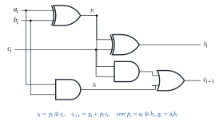
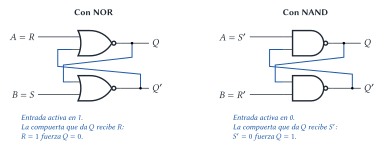

# Diseño Lógico — Parcial 2022 (resuelto)

Examen de opción múltiple. En cada pregunta: el **enunciado**, la **respuesta**, el **porqué**
(incluido por qué las otras opciones no van) y **dónde está en el apunte**.

> **Supuesto.** Las figuras de los ejercicios 4, 5, 8 y 10 no están en el repositorio (en el
> enunciado aparecen como "imagen"). En esos casos se explica **el criterio para decidir** y se
> indica qué se supuso de la figura, para que puedas verificarlo con el original.

## Ejercicio 1 — Minterm

> **Enunciado.** Un _minterm_ es una expresión booleana en la que intervienen todas las variables
> de la función. Se cumple que: (1) es una conjunción que se evalúa como verdadera solo para una
> combinación de esas variables; (2) es una disyunción que se evalúa como verdadera solo para una
> combinación; (3) es una conjunción que se evalúa como falsa solo para una combinación.

> **Respuesta.** **Opción 1.**

**Por qué.** Un minterm es un **producto** (AND = conjunción) de todas las variables, cada una
directa o negada, y vale 1 en **una sola** fila de la tabla. Por ejemplo, con 3 variables,
$x_2'x_1x_0$ vale 1 solo en $011$.

- (2) Una **disyunción** (OR) de todas las variables es un **maxterm**, y vale **0** en una sola
  combinación, no 1.
- (3) Una conjunción de todas las variables vale 0 en **todas menos una** combinación, no en una
  sola.

> **Dónde está en el apunte.** [Formas canónicas](../../../apuntes/07-formas-canonicas.md), §2
> (minterms, SOP), §3 (maxterms, POS) y §4 (notación con índices).

## Ejercicio 2 — Síntesis de una función de 4 variables

> **Enunciado.** La síntesis de una función lógica de 4 variables se puede realizar si se dispone
> de: (1) una ROM de 8 celdas de 4 b y un $MUX_{2\_1}$; (2) una ROM de 16 celdas de 8 b; (3) una ROM
> de 32 celdas de 1 b; (4) ninguna; (5) cualquiera de las tres primeras.

> **Respuesta.** **Opción 5.**

**Por qué.** Hay que ver si en cada caso entran las $2^4 = 16$ filas de la tabla de verdad:

1. **ROM $8 \times 4$ + $MUX_{2\_1}$ (ROM + MUX):** con 3 variables en la dirección (8 celdas) y la
   cuarta, $x_3$, en la selección del MUX. En un bit de la palabra se graba el cofactor
   $f|_{x_3=0}$ y en otro $f|_{x_3=1}$; el MUX elige. **Sirve.**
2. **ROM $16 \times 8$:** 16 celdas = las 16 combinaciones; se usa 1 de los 8 bits. **Sirve.**
3. **ROM $32 \times 1$:** tiene 5 bits de dirección; se conectan las 4 variables y el quinto bit
   en 0 (se usa la mitad). **Sirve.**

> **Dónde está en el apunte.** [Implementación](../../../apuntes/10-implementacion.md), §2.4 (ROM)
> y §2.5 (ROM + MUX, cofactores).

## Ejercicio 3 — ¿Qué entra en un slice?

> **Enunciado.** Según la versión simplificada de _slice_ vista, con un slice se pueden
> implementar simultáneamente: (1) una función de 8 variables y una de 7; (2) una de 8 y una de 6;
> (3) dos funciones de 7 variables; (4) tres de 6 variables y una de 7; (5) cualquiera.

> **Respuesta.** **Opción 3.**

**Por qué.** Recursos de un slice: **4 LUT-6**, 2 MUX F7 y 1 MUX F8. Costo de cada función:

| Función | Recursos |
|---|---|
| hasta 6 variables | 1 LUT |
| 7 variables | 2 LUT + 1 F7 |
| 8 variables | 4 LUT + 2 F7 + F8 (el slice entero) |

- (1) y (2): la de 8 variables ya usa las 4 LUT; no queda nada para la otra. **No sirve.**
- (3): dos de 7 variables = $2 \times (2 \text{ LUT} + \text{F7})$ = 4 LUT y los 2 F7. **Sirve.**
- (4): $3 \times 1 + 2 = 5$ LUT > 4. **No sirve.**

> **Dónde está en el apunte.** [Implementación](../../../apuntes/10-implementacion.md), §2.5.
> Ejemplos dibujados en el [parcial del 13/06/2025](parcial-2025-06-13-resuelto.md), Ejercicio 2.

## Ejercicio 4 — Tiempo de un sumador de 5 b

> **Enunciado.** Sumador binario de 5 b, $r = x + y$, con cada sumador completo implementado según
> una figura. ¿Cuál es el tiempo de estabilización de $r_4$ (el más significativo)? $T_{XOR} = 2$
> ns, $T_{OR} = 4$ ns; las compuertas de 2 y 3 entradas tienen el mismo tiempo. Opciones: (1) 28 ns,
> (2) 30 ns, (3) 35 ns, (4) 45 ns.

> **Supuesto.** Falta la figura y el tiempo de la AND. Se supone el sumador completo del apunte
> (dos semisumadores + OR: $p = x \oplus y$, $s = p \oplus c$, $c_{out} = x y + p\,c$) y
> $T_{AND} = 2$ ns. Es la única combinación razonable que da una de las opciones.

**Cómo se calcula.** El acarreo es lo que se propaga de bit en bit (_ripple carry_):

1. Todos los $p_i$ están listos a los $T_{XOR} = 2$ ns.
2. Bit 0: $c_1 = x_0y_0 + p_0c_0$ → $2 + T_{AND} + T_{OR} = 2 + 2 + 4 = 8$ ns.
3. Cada bit siguiente suma $T_{AND} + T_{OR} = 6$ ns: $c_2 = 14$, $c_3 = 20$, $c_4 = 26$ ns.
4. $r_4 = p_4 \oplus c_4$ → $26 + 2 = 28$ ns.

$$T_{r_4} = T_{XOR} + 4\,(T_{AND} + T_{OR}) + T_{XOR} = 2 + 4 \cdot 6 + 2 = 28 \text{ ns}$$

> **Respuesta.** **Opción 1 (28 ns)**, con el supuesto indicado. Si tu figura es distinta, el
> método es el mismo: seguir el acarreo desde el bit 0 hasta el 4 y sumar al final la XOR de $r_4$.

> **Dónde está en el apunte.** [Sumadores, restadores y comparadores](../../../apuntes/16-sumadores-restadores-y-comparadores.md),
> §3–4. Camino crítico: [Circuitos lógicos combinacionales](../../../apuntes/09-circuitos-logicos-combinacionales.md),
> §4. Ejemplo resuelto con números: [recuperatorio 2025](recuperatorio-2025-resuelto.md), Ejercicio 1.4.

## Ejercicio 5 — ¿Contador sincrónico o asincrónico?

> **Enunciado.** Dado el contador de 4 b de la figura: (1) es sincrónico; (2) es asincrónico; (3)
> puede ser cualquiera, dependiendo de la aplicación.

> **Supuesto.** Falta la figura. Se explica cómo decidir.

**Cómo decidir mirando el circuito.** Seguí la línea de reloj:

- Si **todos** los flip-flops tienen la entrada de reloj conectada a **la misma señal clk** (y
  entre ellos hay compuertas AND que calculan quién conmuta) → **sincrónico** (opción 1).
- Si solo el primero recibe clk y **cada uno usa como reloj la salida ($Q$ o $Q'$) del anterior**
  → **asincrónico** (opción 2).

> **Respuesta.** La opción **3 nunca es correcta**: ser sincrónico o asincrónico es una propiedad
> de **cómo está conectado** el circuito, no de la aplicación. Elegí 1 o 2 según la regla de arriba.

> **Dónde está en el apunte.** [Circuitos contadores](../../../apuntes/19-circuitos-contadores.md),
> §2.3 (_por qué es asincrónico_) y §3. Dibujos de ambos tipos en el
> [recuperatorio 2025](recuperatorio-2025-resuelto.md), Ejercicio 3.

## Ejercicio 6 — ¿De qué depende un circuito combinacional?

> **Enunciado.** Un circuito lógico combinacional depende de: (1) la combinación de entradas; (2)
> la combinación de entradas y estados; (3) la secuencia de entradas a lo largo del tiempo; (4) la
> combinación de entradas y salidas.

> **Respuesta.** **Opción 1.** La salida de un combinacional depende **solo de la combinación
> actual de entradas**. Las opciones 2 y 3 describen un circuito **secuencial** (tiene estado,
> memoria); la 4 implica realimentación de salidas, que también es propio de un secuencial.

> **Dónde está en el apunte.** [Circuitos lógicos combinacionales](../../../apuntes/09-circuitos-logicos-combinacionales.md),
> §1. [Circuitos secuenciales](../../../apuntes/17-circuitos-secuenciales-asincronicos-y-sincronicos.md), §1.

## Ejercicio 7 — Flip-flop D

> **Enunciado.** ¿Qué afirmación es verdadera sobre un _flip-flop D_? (1) Ocupa menos área que un
> _latch D_. (2) Registra un bit en los flancos (alto y bajo) de la señal de sincronización. (3)
> Registra un bit durante el estado (alto o bajo) de la señal de sincronización.

> **Respuesta.** **Opción 2** (la que habla de **flancos**).

**Por qué.**

- (1) **Falsa**: un flip-flop D son **dos latches** en maestro–esclavo: ocupa el **doble** de área.
- (3) **Falsa**: "durante el estado (nivel)" es el comportamiento del **latch** (transparente mientras el
  reloj está en el nivel activo).
- (2) es la que describe al flip-flop: registra en el **flanco**. Ojo con la redacción: un
  flip-flop usa **un** tipo de flanco, ascendente **o** descendente, no los dos.

> **Dónde está en el apunte.** [Circuitos secuenciales](../../../apuntes/17-circuitos-secuenciales-asincronicos-y-sincronicos.md),
> §3 _Latch vs. flip-flop_ y §4 _Maestro–esclavo_.

## Ejercicio 8 — ¿Qué entradas forman un latch SR?

> **Enunciado.** Para que el circuito de la figura implemente un _latch SR_: (1) $A = R$, $B = S$;
> (2) $A = S'$, $B = R$; (3) $A = S$, $B = R$; (4) $A = R'$, $B = S'$.

> **Supuesto.** Falta la figura: son dos compuertas realimentadas, con $A$ entrando a una y $B$ a
> la otra. Hay que ver **qué compuerta es** (NOR o NAND) y **cuál de las dos da $Q$**.

**Cómo decidir.**

- **Con NOR:** un 1 en una entrada fuerza un 0 en la salida de esa compuerta. Para que $R = 1$
  ponga $Q = 0$, $R$ tiene que entrar a la compuerta **que da $Q$**. Si $A$ va a la compuerta de
  $Q$: $A = R$, $B = S$ → **opción 1**.
- **Con NAND:** un 0 en una entrada fuerza un 1 en la salida. Las entradas son **negadas**: $S' = 0$
  tiene que poner $Q = 1$, así que $S'$ entra a la compuerta de $Q$. Si $A$ va a la compuerta de
  $Q'$: $A = R'$, $B = S'$ → **opción 4**.
- Las opciones 2 y 3 mezclan una entrada negada con una sin negar, o ponen $S$ en la compuerta
  equivocada: no forman un latch SR.

> **Respuesta.** Si la figura es la del apunte con **NOR** y $A$ en la compuerta de $Q$:
> **opción 1**. Si es con **NAND** (las dos opciones con entradas negadas apuntan a eso) y $A$
> en la compuerta de $Q'$: **opción 4**.

> **Dónde está en el apunte.** [Circuitos secuenciales](../../../apuntes/17-circuitos-secuenciales-asincronicos-y-sincronicos.md),
> §2.1 _Latch SR con NOR_ y §2.2 _Latch SR con NAND_ (entradas negadas). Presentación _Circuitos
> secuenciales I_ (tablas "A B Q+ Q'+").

## Ejercicio 9 — Registro SIPO

> **Enunciado.** Un registro SIPO de 4 b se tiene que implementar con: (1) cuatro _flip-flop D_;
> (2) cuatro _latch D_; (3) cualquiera.

> **Respuesta.** **Opción 1.** En un registro de desplazamiento cada etapa toma la salida de la
> anterior. Con latches, mientras el reloj está en el nivel activo todos son transparentes a la
> vez y el bit de entrada atravesaría las 4 etapas de una sola vez (no se desplazaría de a una
> posición). Con flip-flops cada bit avanza exactamente una posición por flanco.

> **Dónde está en el apunte.** [Registros](../../../apuntes/20-registros.md), §3.1 (SIPO) y §6
> _Latches vs. flip-flops en registros_. Presentación _Circuitos secuenciales II_ ("Los
> elementos de memoria de los registros de desplazamiento: ¿son latches o flip-flops?").

## Ejercicio 10 — Contador de programa de 8 b

> **Enunciado.** Dado el contador de programa de 8 b de la figura (registro + sumador +1 + MUX de
> salto): (1) se puede implementar con ocho _latch D_; (2) con ocho _flip-flop D_; (3) con
> cualquiera, dependiendo de la aplicación.

> **Respuesta.** **Opción 2.** El registro está en un lazo: su próximo valor es $PC + 1$, calculado
> a partir de su propia salida. Con latches, durante el nivel activo del reloj el valor
> incrementado volvería a entrar y se incrementaría varias veces. Con flip-flops se incrementa una
> vez por flanco.

> **Dónde está en el apunte.** [Circuitos contadores](../../../apuntes/19-circuitos-contadores.md),
> §5.1 y §6. [Circuitos secuenciales](../../../apuntes/17-circuitos-secuenciales-asincronicos-y-sincronicos.md),
> §7. Diseño completo en el [parcial 2024](parcial-2024-resuelto.md), Ejercicio 3.
