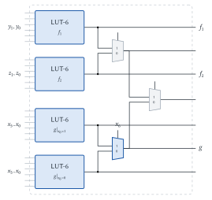
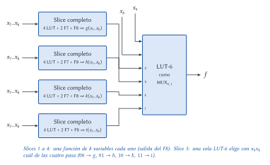
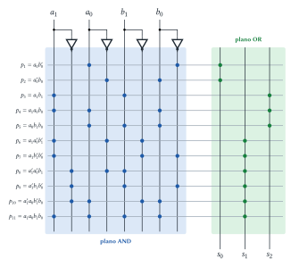
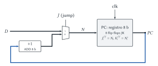

# Diseño Lógico — Parcial 2024 (resuelto)

Cada ejercicio tiene el mismo formato: el **enunciado**, la **idea** para encararlo, la
**resolución** paso a paso y, al final, **dónde está en el apunte** la teoría que se usa.

## Ejercicio 1 — Funciones en slices de FPGA

> **Enunciado.** Implementar con _slices_ de FPGA (dibujar y resaltar los componentes usados): (1)
> dos funciones de 2 variables y una de 7 variables; (2) una función de 10 variables
> $f = x_9'x_8'\,g + x_9'x_8\,h + x_9x_8'\,k + x_9x_8\,t$, donde $g, h, k, t$ son funciones de 8
> variables ($x_7..x_0$).

**Idea general.** En un slice hay 4 LUT-6 (cualquier función de hasta 6 variables), dos MUX F7
(juntan un par de LUT → 7 variables) y un MUX F8 (junta los dos F7 → 8 variables).

### 1.1 Dos funciones de 2 variables y una de 7

- $f_1$, $f_2$ (2 variables): una LUT cada una (sobran entradas; no importa).
- $g$ (7 variables): por **expansión de Shannon** respecto de $x_6$,
  $g = x_6'\,g|_{x_6=0} + x_6\,g|_{x_6=1}$. Cada cofactor es una función de 6 variables → una LUT
  cada uno, y el **MUX F7** con $x_6$ en la selección hace la suma.

Total: 4 LUT + 1 F7 → **un slice**.

### 1.2 Función de 10 variables

**Idea.** La fórmula ya está escrita como un **multiplexor de 4 entradas** con $x_9x_8$ en la
selección: según $x_9x_8$ pasa $g$, $h$, $k$ o $t$. Entonces:

1. Cada una de $g, h, k, t$ es de 8 variables → un **slice completo** cada una (4 LUT con los
   cofactores respecto de $x_7x_6$, dos F7 con $x_6$, F8 con $x_7$). Son **4 slices**.
2. El $MUX_{4\_1}$ final tiene 4 datos + 2 de selección = **6 entradas** → entra en **una LUT-6**
   de un quinto slice.

Contenido de la LUT final (entradas $I_5I_4 = x_9x_8$, $I_3..I_0 = t, k, h, g$): en cada
dirección se graba el valor de la entrada elegida, es decir,
$\text{LUT} = x_9'x_8'\,g + x_9'x_8\,h + x_9x_8'\,k + x_9x_8\,t$.

> **Respuesta.** (1) Un slice: 2 LUT para $f_1, f_2$ y 2 LUT + F7 para $g$. (2) Cinco slices: uno
> completo (4 LUT + 2 F7 + F8) para cada una de $g, h, k, t$, y una LUT de un quinto slice
> funcionando como $MUX_{4\_1}$ con selección $x_9x_8$.

> **Dónde está en el apunte.** [Implementación](../../../apuntes/10-implementacion.md), §2.5
> (cofactores, expansión de Shannon, slice). [Lógica programable](../../../apuntes/23-logica-programable.md),
> §4. Presentación _Síntesis lógica_, diapositivas 26 a 32.

## Ejercicio 2 — Sumador de 2 b con ROM y PLA

> **Enunciado.** Implementar $r = a + b$ con $a$ y $b$ naturales de 2 b y $r$ de 3 b (incluye el
> acarreo final). (1) Con una ROM de 16 celdas de 8 b. (2) Con PLA. (3) Con solo dos ROM de 8 celdas
> de 4 b.

### 2.1 ROM de $16 \times 8$

**Idea.** La ROM guarda la tabla de verdad: dirección $A_3A_2A_1A_0 = a_1a_0b_1b_0$ (16 celdas) y
en cada celda se graba $a + b$ en los bits $D_2D_1D_0$ ($D_7..D_3 = 0$).

| $a_1a_0$ \ $b_1b_0$ | 00 | 01 | 10 | 11 |
|:---:|:---:|:---:|:---:|:---:|
| **00** | 000 | 001 | 010 | 011 |
| **01** | 001 | 010 | 011 | 100 |
| **10** | 010 | 011 | 100 | 101 |
| **11** | 011 | 100 | 101 | 110 |

> **Respuesta.** Contenido de las celdas 0 a 15 (hex):
> `00 01 02 03 01 02 03 04 02 03 04 05 03 04 05 06`. La tabla completa fila por fila está en el
> [recuperatorio del 31/10/2025](recuperatorio-2025-10-31-resuelto.md), Ejercicio 3.1.

### 2.2 Con PLA

**Idea.** Un PLA implementa **sumas de productos**, y los productos se pueden **compartir** entre
salidas. Hay que escribir cada salida como suma de productos (lo más simplificada posible, por
Karnaugh) y programar los dos planos.

**Paso 1: ecuaciones.** Con $c_1 = a_0 b_0$ (acarreo de la columna 0):

- $s_0 = a_0 \oplus b_0 = a_0b_0' + a_0'b_0$ → 2 productos.
- $s_2$ (acarreo final) vale 1 si $a_1 = b_1 = 1$, o si uno de los dos es 1 y hay acarreo:
  $s_2 = a_1b_1 + a_1a_0b_0 + a_0b_1b_0$ → 3 productos.
- $s_1 = a_1 \oplus b_1 \oplus c_1$. Si no hay acarreo ($a_0b_0 = 0$), vale
  $a_1 \oplus b_1$; si hay acarreo, vale lo contrario. En suma de productos (mapa de Karnaugh):

  $$s_1 = a_1a_0'b_1' + a_1b_1'b_0' + a_1'a_0'b_1 + a_1'b_1b_0' + a_1'a_0b_1'b_0 + a_1a_0b_1b_0$$

  → 6 productos.

Total: **11 términos producto**, 4 entradas, 3 salidas.

**Paso 2: programación** (por variable: `10` directa, `01` negada, `00` no aparece):

| Producto | $a_1$ | $a_0$ | $b_1$ | $b_0$ | $s_0$ | $s_1$ | $s_2$ |
|---|:---:|:---:|:---:|:---:|:---:|:---:|:---:|
| $p_1 = a_0b_0'$ | 00 | 10 | 00 | 01 | 1 | 0 | 0 |
| $p_2 = a_0'b_0$ | 00 | 01 | 00 | 10 | 1 | 0 | 0 |
| $p_3 = a_1b_1$ | 10 | 00 | 10 | 00 | 0 | 0 | 1 |
| $p_4 = a_1a_0b_0$ | 10 | 10 | 00 | 10 | 0 | 0 | 1 |
| $p_5 = a_0b_1b_0$ | 00 | 10 | 10 | 10 | 0 | 0 | 1 |
| $p_6 = a_1a_0'b_1'$ | 10 | 01 | 01 | 00 | 0 | 1 | 0 |
| $p_7 = a_1b_1'b_0'$ | 10 | 00 | 01 | 01 | 0 | 1 | 0 |
| $p_8 = a_1'a_0'b_1$ | 01 | 01 | 10 | 00 | 0 | 1 | 0 |
| $p_9 = a_1'b_1b_0'$ | 01 | 00 | 10 | 01 | 0 | 1 | 0 |
| $p_{10} = a_1'a_0b_1'b_0$ | 01 | 10 | 01 | 10 | 0 | 1 | 0 |
| $p_{11} = a_1a_0b_1b_0$ | 10 | 10 | 10 | 10 | 0 | 1 | 0 |

(Las tres columnas de la derecha son el plano OR: un 1 si el producto entra en esa salida.)

> **Respuesta.** PLA de 4 entradas, 11 productos y 3 salidas, con la programación de la tabla.
> Comprobado para las 16 combinaciones de entrada.

### 2.3 Con dos ROM de $8 \times 4$

**Idea.** Con 3 bits de dirección no entran las 4 entradas juntas. Se suma **columna por
columna**, como en papel:

- **ROM$_0$** (columna 0): dirección $a_0\,b_0\,0$ → $D_0 = s_0 = a_0 \oplus b_0$,
  $D_1 = c_1 = a_0b_0$ (semisumador).
- **ROM$_1$** (columna 1): dirección $a_1\,b_1\,c_1$ → $D_0 = s_1$, $D_1 = s_2$ (sumador
  completo).

| Dirección | ROM$_0$ ($D_3..D_0$) | ROM$_1$ ($D_3..D_0$) |
|:---:|:---:|:---:|
| 000 | 0000 | 0000 |
| 001 | – | 0001 |
| 010 | 0001 | 0001 |
| 011 | – | 0010 |
| 100 | 0001 | 0001 |
| 101 | – | 0010 |
| 110 | 0010 | 0010 |
| 111 | – | 0011 |

> **Respuesta.** Dos ROM encadenadas por el acarreo $c_1$ ($D_1$ de ROM$_0$ → $A_0$ de ROM$_1$).
> Es el mismo esquema que el restador del [parcial del 13/06/2025](parcial-2025-06-13-resuelto.md)
> (Ejercicio 1.3), cambiando la tabla.

> **Dónde está en el apunte.** [Implementación](../../../apuntes/10-implementacion.md), §2.3 (PLA,
> codificación `10/01/00`, productos compartidos) y §2.4 (ROM). Karnaugh:
> [Redundancias](../../../apuntes/08-redundancias.md), §3. Sumador:
> [Sumadores, restadores y comparadores](../../../apuntes/16-sumadores-restadores-y-comparadores.md),
> §2–4.

## Ejercicio 3 — Contador de programa de 8 b

> **Enunciado.** Contador de programa de 8 b con entrada $J$ (_jump_): con $J = 0$ se incrementa en
> uno; con $J = 1$ toma el valor de la entrada $D$ (8 b). (1) Implementarlo con _flip-flop JK_. (2)
> ¿Se puede con _latches_? (3) ¿Es sincrónico o asincrónico?

### 3.1 Con flip-flops JK

**Idea.** Igual que en la presentación: el próximo valor es $N = PC + 1$ o $N = D$, y lo elige un
$MUX_{2\_8}$ con $J$ en la selección. Luego se guarda en 8 flip-flops JK conectados como D.

$$N = \begin{cases} PC + 1 & J = 0 \\ D & J = 1 \end{cases}$$

Para que cada JK guarde $N_i$: $J^{ff}_i = N_i$ y $K^{ff}_i = N_i'$ (con $N_i = 1$ hace set, con
$N_i = 0$ hace reset). El $+1$ es un sumador de 8 b con el otro operando en 1 (o una cadena de
semisumadores con acarreo inicial 1).

> **Respuesta.** $N = MUX_{2\_8}(J;\ PC + 1,\ D)$ y un registro de 8 flip-flops JK con
> $J^{ff}_i = N_i$, $K^{ff}_i = N_i'$, todos con el mismo reloj.

### 3.2 ¿Con latches?

> **Respuesta.** **No.** Con $J = 0$ el registro se realimenta a sí mismo a través del sumador
> ($PC = PC + 1$). Con latches, mientras el reloj está en el nivel activo, el valor incrementado
> volvería a entrar y se incrementaría otra vez, varias veces por semiciclo. Con flip-flops se
> incrementa exactamente una vez por flanco.

### 3.3 ¿Sincrónico o asincrónico?

> **Respuesta.** **Sincrónico**: los 8 flip-flops comparten la misma señal de reloj y se
> actualizan en el mismo flanco; el valor siguiente lo calcula la lógica combinacional (sumador y
> MUX) antes del flanco.

> **Dónde está en el apunte.** [Circuitos contadores](../../../apuntes/19-circuitos-contadores.md),
> §5.1 (contador con registro y sumador, "¿qué pasa con latches?") y §6 _Contador de programa_.
> [Circuitos secuenciales](../../../apuntes/17-circuitos-secuenciales-asincronicos-y-sincronicos.md),
> §5 (JK), §7 (por qué flip-flops) y §9 (sincrónico). Presentación _Circuitos secuenciales II_
> (contador de programa).
