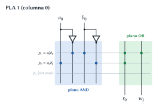
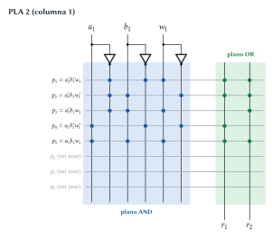
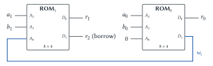
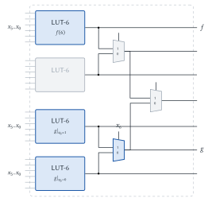
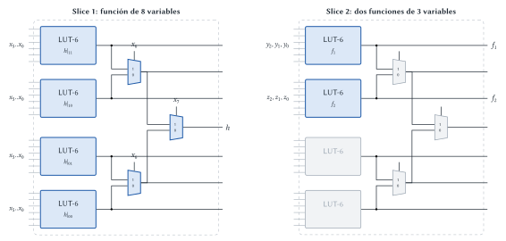
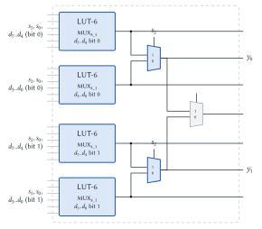
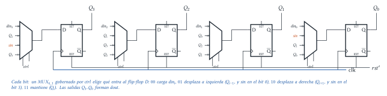
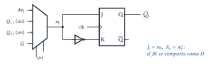

# Diseño Lógico — Parcial 13/06/2025 (resuelto)

Cada ejercicio tiene el mismo formato: el **enunciado**, la **idea** para encararlo, la
**resolución** paso a paso y, al final, **dónde está en el apunte** la teoría que se usa.

## Ejercicio 1 — Restador de 2 b con ROM y PLA

> **Enunciado.** Implementar $r = a - b$ con $a$ y $b$ naturales de 2 b y $r$ de 3 b (contiene el
> _borrow_ final). (1) Con una ROM de 16 celdas de 8 b. (2) Con PLA, usando solo PLA con planos
> AND de 3 entradas y 8 salidas y planos OR de 8 entradas y 2 salidas. (3) Con solo dos ROM de 8
> celdas de 4 b. (4) ¿Las implementaciones son combinacionales o secuenciales? Justificar.

**La función.** $r_1 r_0 = (a - b) \bmod 4$ y $r_2$ es el _borrow_, que vale 1 cuando $a < b$. Un
detalle lindo: los 3 bits $r_2r_1r_0$ quedan iguales a $a - b$ en **complemento a 2** de 3 b (por
ejemplo $0 - 1 = -1 = 111$).

### 1.1 ROM de $16 \times 8$

**Idea.** La ROM es la tabla de verdad. Entradas $a_1a_0b_1b_0$ = 4 bits → 16 direcciones (justo).
Salidas: 3 de los 8 bits de la palabra ($D_2 = r_2$, $D_1 = r_1$, $D_0 = r_0$); el resto en 0.

| $a_1$ | $a_0$ | $b_1$ | $b_0$ | $a - b$ | $r_2$ | $r_1r_0$ | Palabra | Hex |
|:---:|:---:|:---:|:---:|:---:|:---:|:---:|:---:|:---:|
| 0 | 0 | 0 | 0 | 0 − 0 = 0 | 0 | 00 | 00000000 | 00 |
| 0 | 0 | 0 | 1 | 0 − 1 = −1 | 1 | 11 | 00000111 | 07 |
| 0 | 0 | 1 | 0 | 0 − 2 = −2 | 1 | 10 | 00000110 | 06 |
| 0 | 0 | 1 | 1 | 0 − 3 = −3 | 1 | 01 | 00000101 | 05 |
| 0 | 1 | 0 | 0 | 1 − 0 = 1 | 0 | 01 | 00000001 | 01 |
| 0 | 1 | 0 | 1 | 1 − 1 = 0 | 0 | 00 | 00000000 | 00 |
| 0 | 1 | 1 | 0 | 1 − 2 = −1 | 1 | 11 | 00000111 | 07 |
| 0 | 1 | 1 | 1 | 1 − 3 = −2 | 1 | 10 | 00000110 | 06 |
| 1 | 0 | 0 | 0 | 2 − 0 = 2 | 0 | 10 | 00000010 | 02 |
| 1 | 0 | 0 | 1 | 2 − 1 = 1 | 0 | 01 | 00000001 | 01 |
| 1 | 0 | 1 | 0 | 2 − 2 = 0 | 0 | 00 | 00000000 | 00 |
| 1 | 0 | 1 | 1 | 2 − 3 = −1 | 1 | 11 | 00000111 | 07 |
| 1 | 1 | 0 | 0 | 3 − 0 = 3 | 0 | 11 | 00000011 | 03 |
| 1 | 1 | 0 | 1 | 3 − 1 = 2 | 0 | 10 | 00000010 | 02 |
| 1 | 1 | 1 | 0 | 3 − 2 = 1 | 0 | 01 | 00000001 | 01 |
| 1 | 1 | 1 | 1 | 3 − 3 = 0 | 0 | 00 | 00000000 | 00 |

> **Respuesta.** Dirección $A_3A_2A_1A_0 = a_1a_0b_1b_0$; contenido de la celda 0 a la 15:
> `00 07 06 05 01 00 07 06 02 01 00 07 03 02 01 00`.

### 1.2 Con PLA de 3 entradas y 2 salidas

**Idea.** Las salidas dependen de **4** variables, pero cada PLA solo acepta **3** entradas. Hay que
partir el problema. La forma natural es la de restar "a mano", **columna por columna**:

- **Columna 0** depende de $a_0, b_0$: da $r_0 = a_0 \oplus b_0$ y el préstamo
  $w_1 = a_0' b_0$ (hay que pedir prestado cuando $a_0 = 0$ y $b_0 = 1$).
- **Columna 1** depende de $a_1, b_1, w_1$ (¡3 variables!): es un restador completo, da $r_1$ y el
  préstamo final $r_2$.

Cada columna entra en un PLA (3 entradas, 2 salidas). Usamos **2 PLA**.

**PLA 1 (columna 0).** Términos producto: $p_1 = a_0' b_0$, $p_2 = a_0 b_0'$.
$r_0 = p_1 + p_2$ y $w_1 = p_1$ (el término $p_1$ se **comparte**). La tercera entrada no se usa.

**PLA 2 (columna 1).** Tabla del restador completo:

| $a_1$ | $b_1$ | $w_1$ | $r_1$ | $r_2$ |
|:---:|:---:|:---:|:---:|:---:|
| 0 | 0 | 0 | 0 | 0 |
| 0 | 0 | 1 | 1 | 1 |
| 0 | 1 | 0 | 1 | 1 |
| 0 | 1 | 1 | 0 | 1 |
| 1 | 0 | 0 | 1 | 0 |
| 1 | 0 | 1 | 0 | 0 |
| 1 | 1 | 0 | 0 | 0 |
| 1 | 1 | 1 | 1 | 1 |

$r_1 = m_1 + m_2 + m_4 + m_7$ y $r_2 = m_1 + m_2 + m_3 + m_7$. Como el PLA permite **compartir**
términos entre salidas, conviene usar minterms: alcanzan **5** productos
($m_1, m_2, m_3, m_4, m_7$) de los 8 disponibles.

**Programación** con la codificación del apunte (por variable: `10` directa, `01` negada, `00` no
participa):

| PLA 2, plano AND | $a_1$ | $b_1$ | $w_1$ |
|---|:---:|:---:|:---:|
| $p_1 = a_1'b_1'w_1$ | 01 | 01 | 10 |
| $p_2 = a_1'b_1w_1'$ | 01 | 10 | 01 |
| $p_3 = a_1'b_1w_1$ | 01 | 10 | 10 |
| $p_4 = a_1b_1'w_1'$ | 10 | 01 | 01 |
| $p_5 = a_1b_1w_1$ | 10 | 10 | 10 |
| $p_6 \dots p_8$ | 00 | 00 | 00 |

| PLA 2, plano OR | $p_1$ | $p_2$ | $p_3$ | $p_4$ | $p_5$ | $p_6..p_8$ |
|---|:---:|:---:|:---:|:---:|:---:|:---:|
| $r_1$ | 1 | 1 | 0 | 1 | 1 | 0 |
| $r_2$ | 1 | 1 | 1 | 0 | 1 | 0 |

PLA 1: plano AND $p_1 = (01, 10, 00)$, $p_2 = (10, 01, 00)$; plano OR $r_0 = (1, 1)$,
$w_1 = (1, 0)$.

> **Respuesta.** Dos PLA encadenados por el préstamo $w_1$: el primero resuelve la columna 0
> ($r_0$, $w_1$) y el segundo la columna 1 como restador completo ($r_1$, $r_2$), con la
> programación de las tablas.

### 1.3 Con dos ROM de $8 \times 4$

**Idea.** Es exactamente la misma partición que con el PLA: cada ROM de 8 celdas tiene 3 bits de
dirección, y cada columna tiene a lo sumo 3 variables.

| Dirección | ROM$_0$: $A_2A_1A_0 = a_0\,b_0\,0$ → $D_1 = w_1$, $D_0 = r_0$ | ROM$_1$: $A_2A_1A_0 = a_1\,b_1\,w_1$ → $D_1 = r_2$, $D_0 = r_1$ |
|:---:|:---:|:---:|
| 0 (000) | 0000 | 0000 |
| 1 (001) | – (no se usa) | 0011 |
| 2 (010) | 0011 | 0011 |
| 3 (011) | – | 0010 |
| 4 (100) | 0001 | 0001 |
| 5 (101) | – | 0000 |
| 6 (110) | 0000 | 0000 |
| 7 (111) | – | 0011 |

(En ROM$_0$ la entrada $A_0$ se fija en 0, así que las celdas impares no se leen nunca: se pueden
grabar en 0.)

> **Respuesta.** ROM$_0$ hace la columna 0 (semirrestador) y ROM$_1$ la columna 1 (restador
> completo); el préstamo $w_1$ sale de $D_1$ de ROM$_0$ y entra a $A_0$ de ROM$_1$.

### 1.4 ¿Combinacional o secuencial?

> **Respuesta.** Las tres son **combinacionales**: la salida depende solo de los valores actuales
> de $a$ y $b$. No hay realimentación ni elementos de memoria (las ROM y PLA se usan solo para
> leer una tabla fija; el préstamo va "hacia adelante", de una columna a la siguiente, nunca vuelve).

> **Dónde está en el apunte.** ROM y PLA: [Implementación](../../../apuntes/10-implementacion.md),
> §2.3 (incluye la codificación `10/01/00`) y §2.4. Restador completo y préstamo:
> [Sumadores, restadores y comparadores](../../../apuntes/16-sumadores-restadores-y-comparadores.md),
> §5.1. Complemento a 2:
> [Representación de números](../../../apuntes/03-representacion-de-numeros-enteros-fraccionarios-y-negativos.md),
> §4. Combinacional: [Circuitos lógicos combinacionales](../../../apuntes/09-circuitos-logicos-combinacionales.md), §1.

## Ejercicio 2 — Funciones en slices de FPGA

> **Enunciado.** Implementar con _slices_ de FPGA (dibujar y resaltar los componentes usados): (1)
> una función de 6 variables y una de 7; (2) dos funciones de 3 variables y una de 8; (3) un
> $MUX_{8\_2}$.

**Idea general.** Recordar qué hay en un _slice_ y qué puede hacer cada parte:

- **LUT-6:** cualquier función de **hasta 6** variables.
- **MUX F7** (hay dos, cada uno junta un par de LUT): $g = x_6' \cdot g|_{x_6=0} + x_6 \cdot g|_{x_6=1}$.
  Con dos LUT + F7 se hace cualquier función de **7** variables (expansión de Shannon: cada LUT
  calcula un cofactor y la séptima variable elige).
- **MUX F8:** junta las salidas de los dos F7 → cualquier función de **8** variables usando el slice
  completo.

### 2.1 Una función de 6 y una de 7 variables

- $f(x_5..x_0)$: **una LUT**.
- $g(x_6..x_0)$: **dos LUT** con los cofactores $g|_{x_6=0}$ y $g|_{x_6=1}$ (funciones de 6
  variables) y el **MUX F7** con $x_6$ en la selección.

Total 3 LUT y un F7: **entra en un slice** (sobran una LUT, un F7 y el F8).

### 2.2 Dos funciones de 3 variables y una de 8

- $h(x_7..x_0)$: necesita el **slice completo**: las 4 LUT guardan los cofactores respecto de
  $x_7x_6$ ($h|_{11}, h|_{10}, h|_{01}, h|_{00}$), los dos F7 eligen con $x_6$ y el F8 con $x_7$.
- $f_1$ y $f_2$ (3 variables): una LUT cada una, en un **segundo slice**.

### 2.3 $MUX_{8\_2}$

**Idea.** Un $MUX_{8\_2}$ tiene 8 entradas de **2 b** ($d_7..d_0$), selección de 3 b ($s_2s_1s_0$)
y salida de 2 b. Cada bit de salida es un $MUX_{8\_1}$: 8 datos + 3 selección = 11 variables, no
entra en una LUT. Pero se puede **partir como un MUX**:

- Una LUT-6 hace un $MUX_{4\_1}$ (4 datos + 2 de selección = 6 variables).
- Dos $MUX_{4\_1}$ + un MUX F7 con $s_2$ en la selección = un $MUX_{8\_1}$ (es la construcción
  jerárquica de multiplexores del apunte).

Para los 2 bits: 4 LUT y los 2 F7 → **un slice** (el F8 no se usa).

> **Respuesta.** (1) Un slice: 1 LUT para $f$; 2 LUT + MUX F7 para $g$. (2) Dos slices: uno entero
> (4 LUT + 2 F7 + F8) para la función de 8 variables y otro con 2 LUT para las de 3. (3) Un slice:
> cada par de LUT funciona como dos $MUX_{4\_1}$ ($s_1s_0$) y el F7 elige con $s_2$; un par por
> cada bit de salida.

> **Dónde está en el apunte.** [Implementación](../../../apuntes/10-implementacion.md), §2.5 (ROM +
> MUX, cofactores y expansión de Shannon, slice de 4 LUT-6). MUX jerárquicos:
> [Multiplexores y demultiplexores](../../../apuntes/15-multiplexores-y-demultiplexores.md), §1.3–1.5.
> Presentación _Síntesis lógica_, diapositivas 26 a 32.

## Ejercicio 3 — Registro universal de 4 b

> **Enunciado.** Registro universal de 4 b con reset asincrónico, control $ctrl$ de 2 b, entrada
> paralela $din$ (4 b), entrada serie $sin$ y salida $dout = Q$:
> $ctrl = 00$ carga paralela ($Q^+ = din$); $01$ desplaza a izquierda ($Q^+[i] = Q[i-1]$,
> $Q^+[0] = sin$); $10$ desplaza a derecha ($Q^+[i] = Q[i+1]$, $Q^+[3] = sin$); $11$ mantiene.
> (1) Con _flip-flop D_. (2) Con _flip-flop JK_. (3) ¿Se puede con _latches_?

### 3.1 Con flip-flops D

**Idea.** Un flip-flop D por bit. Lo único que cambia según la operación es **qué valor entra** a
cada flip-flop: eso lo decide un $MUX_{4\_1}$ por bit, con $ctrl$ en la selección.

| $ctrl$ | Entrada del MUX | Bit 3 | Bit 2 | Bit 1 | Bit 0 |
|:---:|---|:---:|:---:|:---:|:---:|
| 00 | carga | $din_3$ | $din_2$ | $din_1$ | $din_0$ |
| 01 | izquierda | $Q_2$ | $Q_1$ | $Q_0$ | $sin$ |
| 10 | derecha | $sin$ | $Q_3$ | $Q_2$ | $Q_1$ |
| 11 | mantiene | $Q_3$ | $Q_2$ | $Q_1$ | $Q_0$ |

Fijate que "mantener" se hace **realimentando $Q_i$** por el MUX, no tocando el reloj (como dice
el apunte, intervenir la línea de reloj es una solución inválida).

### 3.2 Con flip-flops JK

**Idea.** Un JK se comporta como un D si se conecta $J = m$ y $K = m'$: con $m = 1$ queda $J = 1,
K = 0$ (set → $Q^+ = 1$); con $m = 0$, $J = 0, K = 1$ (reset → $Q^+ = 0$). Entonces se usa el
mismo MUX de antes y se reemplaza cada D por un JK con un inversor.

> **Ojo.** Se puede ahorrar algo para el caso "mantener": con $ctrl = 11$ alcanza con $J = K = 0$.
> Pero la versión $J = m_i$, $K = m_i'$ es correcta, simple y fácil de justificar.

### 3.3 ¿Con latches?

> **Respuesta.** **No.** En los desplazamientos y en "mantener", la entrada de cada bit depende de
> salidas del propio registro ($Q_{i-1}$, $Q_{i+1}$ o $Q_i$). Con latches, durante el nivel activo
> del reloj el dato desplazado pasaría a la salida y volvería a desplazarse en el mismo semiciclo
> (el valor "correría" varias posiciones). Con flip-flops el desplazamiento es exactamente de una
> posición por flanco.

> **Dónde está en el apunte.** [Registros](../../../apuntes/20-registros.md): §2.2 habilitación con
> MUX en la línea de datos, §3 registros de desplazamiento, §4 _Registro universal_, §6 _Latches vs.
> flip-flops en registros_. JK: [Circuitos secuenciales](../../../apuntes/17-circuitos-secuenciales-asincronicos-y-sincronicos.md),
> §5. Presentación _Circuitos secuenciales II_ (registro universal y "¿son latches o flip-flops?").
