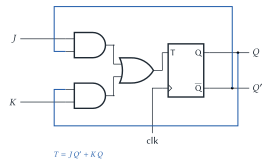
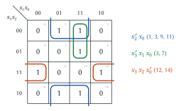
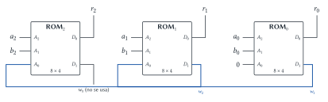
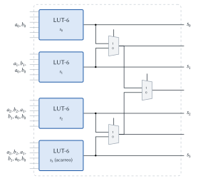

# Diseño Lógico — Parcial 03/10/2025 (resuelto)

Cada ejercicio tiene el mismo formato: el **enunciado**, la **idea** para encararlo, la
**resolución** paso a paso y, al final, **dónde está en el apunte** la teoría que se usa.

## Ejercicio 1 — Contador sincrónico de 4 b

> **Enunciado.** Implementar un contador sincrónico de 4 b. (1) Graficar el circuito, definiendo el
> tipo de _flip-flop_ elegido. (2) Describir ventajas y desventajas de un contador sincrónico
> respecto de uno asincrónico.

### 1.1 Circuito

**Idea.** En un contador **sincrónico** todos los flip-flops reciben **el mismo reloj**. Entonces
no se puede usar "el bit anterior como reloj"; hay que decidir, mirando el **estado** actual, qué
bits tienen que cambiar en el próximo flanco (el "análisis por estado" del apunte).

Elegimos **flip-flops T**, porque "cambiar o no cambiar" es justo lo que hace un T: con $T = 1$
conmuta, con $T = 0$ mantiene.

**Paso 1: ¿cuándo cambia cada bit?** Mirando la secuencia binaria:

| $Q_3$ | $Q_2$ | $Q_1$ | $Q_0$ | Bits que cambian al sumar 1 |
|:---:|:---:|:---:|:---:|---|
| 0 | 0 | 0 | 0 | $Q_0$ |
| 0 | 0 | 0 | 1 | $Q_0, Q_1$ |
| 0 | 0 | 1 | 0 | $Q_0$ |
| 0 | 0 | 1 | 1 | $Q_0, Q_1, Q_2$ |
| 0 | 1 | 1 | 1 | $Q_0, Q_1, Q_2, Q_3$ |

- $Q_0$ cambia **siempre** → $T_0 = 1$.
- $Q_1$ cambia cuando $Q_0 = 1$ → $T_1 = Q_0$.
- $Q_2$ cambia cuando $Q_1 = Q_0 = 1$ → $T_2 = Q_1 Q_0$.
- $Q_3$ cambia cuando $Q_2 = Q_1 = Q_0 = 1$ → $T_3 = Q_2 Q_1 Q_0$.

Regla general: **un bit cambia cuando todos los bits menos significativos valen 1** (es el acarreo
de sumar 1).

**Paso 2: circuito.** Las AND se encadenan ($T_3 = T_2 \cdot Q_2$) para no repetir compuertas.

> **Respuesta.** Cuatro flip-flops T con el mismo reloj, $T_0 = 1$, $T_1 = Q_0$, $T_2 = Q_1Q_0$,
> $T_3 = Q_2Q_1Q_0$ (dos compuertas AND de 2 entradas).

### 1.2 Sincrónico vs. asincrónico

> **Respuesta.**
>
> | | Sincrónico | Asincrónico |
> |---|---|---|
> | Reloj | El mismo para todos los flip-flops | Cada flip-flop usa la salida del anterior |
> | Actualización | Todos los bits cambian a la vez, un $t_{prop}$ después del flanco | Los cambios se propagan bit a bit ("en cascada") |
> | Estados intermedios | No hay: la salida pasa limpia de un valor al siguiente | Hay valores falsos transitorios (ej. de 0111 a 1000 pasa por 0110, 0100, 0000) |
> | Velocidad | No depende de la cantidad de bits (solo de las AND) | El retardo crece con la cantidad de bits ($n \cdot t_{prop}$) |
> | Área | Mayor: necesita compuertas AND | Menor: solo flip-flops |
>
> **Ventajas del sincrónico:** salidas estables y simultáneas, sin estados transitorios, más
> rápido para muchos bits y fácil de integrar con el resto de un sistema sincrónico.
> **Desventaja:** ocupa más área (lógica extra para calcular las $T_i$).

> **Dónde está en el apunte.** [Circuitos contadores](../../../apuntes/19-circuitos-contadores.md),
> §3 _Contador sincrónico_ (§3.1 análisis por estado, §3.2 implementación, §3.3 comparación) y §2
> para el asincrónico. Flip-flop T: [Circuitos secuenciales](../../../apuntes/17-circuitos-secuenciales-asincronicos-y-sincronicos.md),
> §6. Presentación _Circuitos secuenciales II_ ("Caso 2").

## Ejercicio 2 — Preguntas

> **Enunciado.** (1) Implementar un _flip-flop JK_ utilizando _flip-flop T_. (2) Diferenciar entre
> circuitos secuenciales y combinacionales. (3) Mencionar las técnicas de síntesis vistas. (4)
> Simplificar por Karnaugh $f = \sum m(1, 3, 7, 9, 11, 12, 14)$. (5) ¿Qué es un minterm?

### 2.1 Flip-flop JK con flip-flop T

**Idea.** Un T **conmuta** cuando $T = 1$. Entonces hay que poner $T = 1$ exactamente en los casos
donde el JK tiene que **cambiar** de estado ($Q^+ \neq Q$).

| $J$ | $K$ | $Q$ | $Q^+$ (JK) | ¿Cambia? → $T$ |
|:---:|:---:|:---:|:---:|:---:|
| 0 | 0 | 0 | 0 | 0 |
| 0 | 0 | 1 | 1 | 0 |
| 0 | 1 | 0 | 0 | 0 |
| 0 | 1 | 1 | 0 | 1 |
| 1 | 0 | 0 | 1 | 1 |
| 1 | 0 | 1 | 1 | 0 |
| 1 | 1 | 0 | 1 | 1 |
| 1 | 1 | 1 | 0 | 1 |

Los unos de $T$: con $Q = 0$ cuando $J = 1$ (filas 100, 110) y con $Q = 1$ cuando $K = 1$ (filas
011, 111):

$$T = J\,Q' + K\,Q$$

> **Respuesta.** $T = JQ' + KQ$: "si estoy en 0 cambio cuando $J = 1$; si estoy en 1 cambio cuando
> $K = 1$".

### 2.2 Secuenciales vs. combinacionales

> **Respuesta.** En un circuito **combinacional** las salidas dependen **solo de la combinación
> actual de entradas**: la misma entrada siempre da la misma salida (sumadores, MUX,
> decodificadores). En un circuito **secuencial** las salidas dependen de las entradas **y del
> estado** en que se encuentra el circuito, es decir, de la historia de entradas anteriores: tiene
> **memoria**. Estructuralmente, el secuencial tiene **realimentación** (salidas que vuelven a
> entrar) y elementos de memoria (latches, flip-flops).

### 2.3 Técnicas de síntesis

> **Respuesta.** (1) Compuertas AND–OR–INV, (2) multiplexores, (3) PLA (planos AND y OR
> programables), (4) ROM (plano AND fijo = decodificador, plano OR programable) y (5) ROM + MUX,
> que es la base de las LUT y _slices_ de las FPGA. La explicación con un ejemplo de cada una está
> en el Ejercicio 2 del [final del 20/02/2026](final-2026-02-20-resuelto.md).

### 2.4 Karnaugh de $f = \sum m(1, 3, 7, 9, 11, 12, 14)$

**Idea.** Cuatro variables $x_3x_2x_1x_0$ (el minterm $m_i$ es el número $i$ en binario). Se arma
el mapa con el orden de Gray (00, 01, 11, 10) para que las casillas vecinas difieran en un solo
bit, se ponen los unos y se agrupan en rectángulos de 1, 2, 4 u 8 casillas lo **más grandes
posible**, recordando que los bordes se tocan.

**Grupos:**

1. **Azul (4 casillas): 1, 3, 9, 11.** Filas $x_3x_2 = 00$ y $10$ (vecinas por el borde) y columnas
   $x_1x_0 = 01$ y $11$. Lo que no cambia: $x_2 = 0$ y $x_0 = 1$ → $x_2'\,x_0$.
2. **Verde (2 casillas): 3, 7.** El 7 solo tiene un vecino en 1 (el 3). Columna 11, filas 00 y 01:
   $x_3 = 0$, $x_1 = 1$, $x_0 = 1$ → $x_3'\,x_1\,x_0$.
3. **Naranja (2 casillas): 12, 14.** Fila 11, columnas 00 y 10 (vecinas por el borde): $x_3 = 1$,
   $x_2 = 1$, $x_0 = 0$ → $x_3\,x_2\,x_0'$.

> **Respuesta.** $f = x_2'\,x_0 + x_3'\,x_1\,x_0 + x_3\,x_2\,x_0'$.

### 2.5 Minterm

> **Respuesta.** Un **minterm** (minitérmino) es un **producto (AND)** en el que aparecen **todas**
> las variables de la función, cada una directa o negada. Vale 1 para **una sola** combinación de
> entradas (por ejemplo, con 3 variables, $x_2'x_1x_0 = m_3$ solo vale 1 en $011$). La suma de los
> minterms donde la función vale 1 es la forma canónica disyuntiva.

> **Dónde está en el apunte.** JK y T:
> [Circuitos secuenciales](../../../apuntes/17-circuitos-secuenciales-asincronicos-y-sincronicos.md),
> §5–6 (la presentación _Circuitos secuenciales I_ deja "JK usando T" como ejercicio).
> Combinacional vs. secuencial: mismo apunte §1 y
> [Circuitos lógicos combinacionales](../../../apuntes/09-circuitos-logicos-combinacionales.md), §1.
> Técnicas: [Implementación](../../../apuntes/10-implementacion.md), §2. Karnaugh:
> [Redundancias](../../../apuntes/08-redundancias.md), §3 (§3.5 ejemplo de 4 variables). Minterm:
> [Formas canónicas](../../../apuntes/07-formas-canonicas.md), §2 y §4.

## Ejercicio 3 — Síntesis con ROM y con slices

> **Enunciado.** (1) Sintetizar con ROMs de 8 celdas de 4 b (pueden ser varias) un restador
> $r = a - b$ con $a$, $b$ y $r$ de 3 b. (2) Sintetizar con _slices_ de FPGA un sumador $s = a + b$
> con $a$ y $b$ de 3 b y $s$ de 4 b, especificando la función de cada componente.

### 3.1 Restador de 3 b con ROMs de $8 \times 4$

**Idea.** Una ROM de 8 celdas tiene **3 bits de dirección**: entran 3 variables. El restador
completo tiene 6 entradas ($a_2a_1a_0b_2b_1b_0$), no entra en una sola. Pero se puede partir igual
que un restador "a mano", **columna por columna**: cada columna necesita solo $a_i$, $b_i$ y el
préstamo $w_i$ que viene de la columna anterior. ¡Son 3 variables! Una ROM por columna, que
implementa un **restador completo**:

$$r_i = a_i \oplus b_i \oplus w_i \qquad w_{i+1} = a_i'\,b_i + a_i'\,w_i + b_i\,w_i$$

**Contenido (igual en las tres ROM).** Dirección $A_2A_1A_0 = a_i\,b_i\,w_i$; se usan $D_0 = r_i$
y $D_1 = w_{i+1}$; $D_3D_2 = 00$.

| Dir. | $a_i$ | $b_i$ | $w_i$ | $a_i - b_i - w_i$ | $w_{i+1}$ ($D_1$) | $r_i$ ($D_0$) | Palabra $D_3..D_0$ |
|:---:|:---:|:---:|:---:|:---:|:---:|:---:|:---:|
| 0 | 0 | 0 | 0 | 0 | 0 | 0 | 0000 |
| 1 | 0 | 0 | 1 | $-1$ | 1 | 1 | 0011 |
| 2 | 0 | 1 | 0 | $-1$ | 1 | 1 | 0011 |
| 3 | 0 | 1 | 1 | $-2$ | 1 | 0 | 0010 |
| 4 | 1 | 0 | 0 | 1 | 0 | 1 | 0001 |
| 5 | 1 | 0 | 1 | 0 | 0 | 0 | 0000 |
| 6 | 1 | 1 | 0 | 0 | 0 | 0 | 0000 |
| 7 | 1 | 1 | 1 | $-1$ | 1 | 1 | 0011 |

(Cuando la resta da negativa se "pide prestado" 2: por ejemplo $0 - 1 = -1 = -2 + 1$ → $r = 1$,
$w = 1$.)

La ROM$_0$ recibe $w_0 = 0$. El préstamo final $w_3$ no se usa porque el resultado es de 3 b (el
resultado queda módulo 8, igual que en complemento a 2).

**Ejemplo.** $a = 5 = 101$, $b = 3 = 011$: ROM$_0$ ($1,1,0$) → $r_0 = 0$, $w_1 = 0$; ROM$_1$
($0,1,0$) → $r_1 = 1$, $w_2 = 1$; ROM$_2$ ($1,0,1$) → $r_2 = 0$. $r = 010 = 2$, que es $5 - 3$.

> **Respuesta.** Tres ROM de $8 \times 4$, una por bit, cada una programada como restador completo
> (tabla de arriba), encadenadas por el préstamo: $D_1$ de ROM$_i$ va a $A_0$ de ROM$_{i+1}$.

> **Ojo.** Otra opción válida es usar ROM + MUX (descomponer por variables con multiplexores),
> pero encadenar restadores completos es lo más directo y usa solo ROMs, como pide el enunciado.

### 3.2 Sumador de 3 b con slices de FPGA

**Idea.** Contar variables de cada bit de salida: si no pasan de 6, cada salida es **una LUT-6**.

| Salida | Depende de | Variables |
|---|---|:---:|
| $s_0$ | $a_0, b_0$ | 2 |
| $s_1$ | $a_1, b_1, a_0, b_0$ | 4 |
| $s_2$ | $a_2, b_2, a_1, b_1, a_0, b_0$ | 6 |
| $s_3$ (acarreo final) | $a_2, b_2, a_1, b_1, a_0, b_0$ | 6 |

Las cuatro entran en LUT-6 → alcanza **un solo slice**, sin usar sus multiplexores.

**Función de cada componente** ($c_i$ = acarreo hacia la columna $i$):

- **LUT 1:** $s_0 = a_0 \oplus b_0$.
- **LUT 2:** $s_1 = a_1 \oplus b_1 \oplus c_1$, con $c_1 = a_0 b_0$.
- **LUT 3:** $s_2 = a_2 \oplus b_2 \oplus c_2$, con $c_2 = a_1 b_1 + (a_1 \oplus b_1)\,c_1$.
- **LUT 4:** $s_3 = c_3 = a_2 b_2 + (a_2 \oplus b_2)\,c_2$ (vale 1 cuando $a + b \geq 8$).
- **MUX F7 y F8:** no se usan.

Cada LUT guarda la tabla de verdad de su función. Con entradas
$I_5..I_0 = b_2\,a_2\,b_1\,a_1\,b_0\,a_0$ (bit $k$ del número = celda de dirección $k$):

| LUT | Contenido (64 b, hex) |
|---|---|
| $s_0$ | `6666666666666666` |
| $s_1$ | `8778877887788778` |
| $s_2$ | `F880077F077FF880` |
| $s_3$ | `FFFFF880F8800000` |

> **Respuesta.** Un slice: LUT 1 → $s_0$, LUT 2 → $s_1$, LUT 3 → $s_2$, LUT 4 → $s_3$, cada una con
> la tabla de verdad de la suma para ese bit; los MUX del slice quedan sin usar.

> **Dónde está en el apunte.** ROM: [Implementación](../../../apuntes/10-implementacion.md), §2.4;
> slice y LUT: §2.5 y [Lógica programable](../../../apuntes/23-logica-programable.md), §4.
> Restador y sumador completo:
> [Sumadores, restadores y comparadores](../../../apuntes/16-sumadores-restadores-y-comparadores.md),
> §3, §4 y §5.1.
