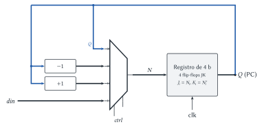

# Diseño Lógico — Parcial 2025 (resuelto)

Cada ejercicio tiene el mismo formato: el **enunciado**, la **idea** para encararlo, la
**resolución** paso a paso y, al final, **dónde está en el apunte** la teoría que se usa.

## Ejercicio 1 — Contador de programa de 4 b con flip-flops JK

> **Enunciado.** Implementar mediante esquemático un contador de programa de 4 b basado en
> _flip-flop JK_, con una señal $ctrl$ de 2 b: $00$ mantiene, $01$ decrementa en uno, $10$
> incrementa en uno, $11$ carga la entrada $din$ de 4 b.

**Idea.** Separar el problema en dos partes, como el contador de programa de la presentación:

1. **Calcular el próximo valor $N$** (combinacional): las cuatro opciones posibles ($Q$, $Q - 1$,
   $Q + 1$, $din$) entran a un $MUX_{4\_4}$ y $ctrl$ elige cuál pasa.
2. **Guardarlo** en un registro de 4 b hecho con flip-flops JK, todos con el mismo reloj.

**Paso 1: las cuatro opciones.**

| $ctrl$ | $N$ | Cómo se obtiene |
|:---:|---|---|
| 00 | $Q$ | realimentación directa (mantener sin tocar el reloj) |
| 01 | $Q - 1$ | decrementador |
| 10 | $Q + 1$ | incrementador |
| 11 | $din$ | entrada externa |

El **incrementador** es una cadena de semisumadores con acarreo inicial 1:
$N_i = Q_i \oplus c_i$, $c_{i+1} = Q_i\,c_i$, $c_0 = 1$. El **decrementador** es una cadena de
semirrestadores con préstamo inicial 1: $N_i = Q_i \oplus w_i$, $w_{i+1} = Q_i'\,w_i$, $w_0 = 1$
(un bit cambia cuando todos los de abajo son 0).

**Paso 2: el JK como registro.** Para que un JK guarde $N_i$ en el flanco se conecta
$J_i = N_i$ y $K_i = N_i'$: si $N_i = 1$ → $J = 1, K = 0$ (set); si $N_i = 0$ → $J = 0, K = 1$
(reset).



> **Respuesta.** $N = MUX_{4\_4}(ctrl;\ Q,\ Q - 1,\ Q + 1,\ din)$ y cuatro flip-flops JK con el
> mismo reloj, $J_i = N_i$, $K_i = N_i'$. La salida $Q$ es el valor del contador de programa.

> **Ojo.** También se puede diseñar "a lo JK" (calcular $J_i$ y $K_i$ con tablas de excitación
> para cada $ctrl$), pero sale mucho más largo. La solución con MUX + registro es la de la
> cátedra (contador ascendente/descendente y contador de programa de la presentación).

> **Dónde está en el apunte.** [Circuitos contadores](../../../apuntes/19-circuitos-contadores.md),
> §5.1 (contador con registro y sumador), §5.2 (ascendente/descendente) y §6 _Contador de
> programa_. Registro con MUX en la línea de datos: [Registros](../../../apuntes/20-registros.md),
> §2.2. JK: [Circuitos secuenciales](../../../apuntes/17-circuitos-secuenciales-asincronicos-y-sincronicos.md),
> §5.

## Ejercicio 2 — ALU en VHDL

> **Enunciado.** Describir en VHDL una ALU con control $ctrl$ de 2 b, operandos $a$ y $b$ de 8 b y
> resultado $r$ de 8 b: $00$ → $a + b$; $01$ → $a$; $10$ → $a \text{ OR } b$; $11$ →
> $a \text{ AND } b$.

**Idea.** Es un circuito **combinacional**: un **multiplexor** que elige entre cuatro resultados.
En VHDL lo más claro es una asignación concurrente con `with ... select` (o un `process` con
`case`). Para sumar se usan vectores `unsigned` del paquete `numeric_std`; el resultado de 8 b
descarta el acarreo final.

```vhdl
library ieee;
use ieee.std_logic_1164.all;
use ieee.numeric_std.all;

entity alu is
  port (
    a, b : in  std_logic_vector(7 downto 0);
    ctrl : in  std_logic_vector(1 downto 0);
    r    : out std_logic_vector(7 downto 0)
  );
end alu;

architecture comportamiento of alu is
  signal suma : std_logic_vector(7 downto 0);
begin
  suma <= std_logic_vector(unsigned(a) + unsigned(b));

  with ctrl select
    r <= suma    when "00",
         a       when "01",
         a or b  when "10",
         a and b when others;  -- "11"
end comportamiento;
```

Versión equivalente con un proceso (la lista de sensibilidad tiene **todas** las entradas porque
es combinacional):

```vhdl
process (a, b, ctrl)
begin
  case ctrl is
    when "00"   => r <= std_logic_vector(unsigned(a) + unsigned(b));
    when "01"   => r <= a;
    when "10"   => r <= a or b;
    when others => r <= a and b;
  end case;
end process;
```

> **Ojo.** Usar `when others` en lugar de `when "11"`: `std_logic` tiene más valores que 0 y 1
> (`'U'`, `'X'`, `'Z'`...), y el `case` tiene que cubrir todos.

> **Dónde está en el apunte.** [Lenguajes de programación HDL](../../../apuntes/22-lenguajes-de-programacion-hdl.md):
> §5 entidad y arquitectura, §6 puertos, §9 operadores, §10 diseño concurrente, §11–12 procesos y
> `case`, §16 paquetes (`numeric_std`) y §17 multiplexores en VHDL. ALU:
> [Sumadores, restadores y comparadores](../../../apuntes/16-sumadores-restadores-y-comparadores.md), §7.

## Ejercicio 3 — Preguntas

> **Enunciado.** (1) Diferencias entre circuitos combinacionales y secuenciales. (2) ¿El contador
> del Ejercicio 1 es sincrónico o asincrónico? (3) ¿Cuándo conviene un _latch_ y cuándo un
> _flip-flop_? (4) Análisis de tiempo de cálculo de un $MUX_{8\_4}$.

### 3.1 Combinacionales vs. secuenciales

> **Respuesta.** **Combinacional:** la salida depende solo de la combinación actual de entradas.
> **Secuencial:** depende de las entradas y del **estado** (tiene memoria, realimentación y
> elementos de memoria). La ALU del Ejercicio 2 es combinacional; el contador del Ejercicio 1 es
> secuencial.

### 3.2 ¿El contador es sincrónico?

> **Respuesta.** **Sincrónico**: los cuatro flip-flops JK reciben la **misma** señal de reloj y se
> actualizan en el mismo flanco. El próximo valor lo calcula la lógica combinacional (MUX,
> incrementador, decrementador) antes del flanco; ningún flip-flop usa como reloj la salida de
> otro (eso sería asincrónico).

### 3.3 Latch vs. flip-flop

> **Respuesta.** **Flip-flop** cuando el registro está en un lazo, es decir, su entrada depende de
> su propia salida (como el contador del Ejercicio 1: $Q^+ = Q \pm 1$). Con un latch, mientras el
> reloj está en el nivel activo el valor daría varias vueltas por el incrementador y el contador
> avanzaría más de una vez. **Latch** cuando no hay realimentación (guardar un dato que viene de
> afuera): funciona y ocupa la mitad del área.

### 3.4 Tiempo de un $MUX_{8\_4}$

**Idea.** El $MUX_{8\_4}$ (8 entradas de 4 b) son **4 árboles** de $MUX_{2\_1}$ (uno por bit)
**en paralelo**. Cada árbol tiene $\log_2 8 = 3$ niveles. El ancho del bus (4 b) agrega área, pero
**no** tiempo.

$$T_{MUX_{2\_1}} = T_{AND} + T_{OR} \qquad T_{MUX_{8\_4}} = 3\,T_{MUX_{2\_1}} = 3\,(T_{AND} + T_{OR})$$

(Si se cuenta el inversor de la selección: $T_{NOT} + 3\,(T_{AND} + T_{OR})$, porque los
inversores de $s_0, s_1, s_2$ trabajan en paralelo al principio.) Área, por si se pide:
$4 \times 7 = 28$ $MUX_{2\_1}$ = 56 AND + 28 OR. El dibujo del árbol está en el
[recuperatorio 2025](recuperatorio-2025-resuelto.md), Ejercicio 2.3.

> **Respuesta.** $T_{MUX_{8\_4}} = 3\,(T_{AND} + T_{OR})$: tres niveles de $MUX_{2\_1}$, igual
> que un $MUX_{8\_1}$, porque los 4 bits se calculan en paralelo.

> **Dónde está en el apunte.** [Multiplexores y demultiplexores](../../../apuntes/15-multiplexores-y-demultiplexores.md),
> §1.3–1.5 (tiempo logarítmico, área lineal, buses). Latch vs. flip-flop:
> [Circuitos secuenciales](../../../apuntes/17-circuitos-secuenciales-asincronicos-y-sincronicos.md),
> §3 y §7. Sincrónico vs. asincrónico: mismo apunte §9 y
> [Circuitos contadores](../../../apuntes/19-circuitos-contadores.md), §3.3.
