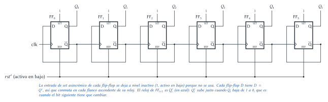
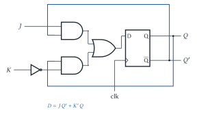
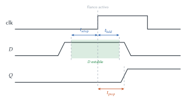
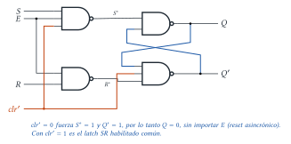
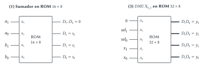
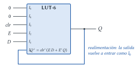

# Diseño Lógico — Recuperatorio 31/10/2025 (resuelto)

Cada ejercicio tiene el mismo formato: el **enunciado**, la **idea** para encararlo, la
**resolución** paso a paso y, al final, **dónde está en el apunte** la teoría que se usa.

## Ejercicio 1 — Contador asincrónico de 6 b con flip-flops D

> **Enunciado.** Implementar un contador asincrónico de 6 b basado en _flip-flop D_.

**Idea.** Si se mira la secuencia de un contador binario **bit por bit** (el "análisis por evento"
del apunte):

| $Q_2$ | $Q_1$ | $Q_0$ |
|:---:|:---:|:---:|
| 0 | 0 | 0 |
| 0 | 0 | 1 |
| 0 | 1 | 0 |
| 0 | 1 | 1 |
| 1 | 0 | 0 |

- $Q_0$ cambia en **cada** flanco de reloj.
- $Q_1$ cambia **solo cuando $Q_0$ pasa de 1 a 0**.
- En general, $Q_{i+1}$ cambia cuando $Q_i$ pasa de 1 a 0.

Entonces cada bit es un elemento que **conmuta** (un flip-flop T con $T = 1$) y su reloj es el bit
anterior. Dos detalles para hacerlo con flip-flops D:

1. **Conmutar con un D:** si se conecta $D = Q'$, en cada flanco el flip-flop guarda lo contrario
   de lo que tenía. Es un "T con $T = 1$".
2. **Flanco correcto:** los flip-flops se disparan en el flanco **ascendente**, pero $Q_{i+1}$
   tiene que cambiar en el flanco **descendente** de $Q_i$. El flanco descendente de $Q_i$ es el
   ascendente de $Q_i'$, así que el reloj de FF$_{i+1}$ es $Q_i'$.

**Resolución.**

- FF$_0$: reloj = clk, $D_0 = Q_0'$.
- FF$_i$ ($i = 1 \dots 5$): reloj = $Q_{i-1}'$, $D_i = Q_i'$.
- Todos comparten el reset asincrónico, para arrancar en $000000$. La entrada de _set_
  asincrónico no se usa, pero **no se deja flotando**: se conecta a su nivel inactivo (1, si es
  activo en bajo).
- La salida es $Q_5 Q_4 Q_3 Q_2 Q_1 Q_0$ y cuenta de 0 a 63 y vuelve a 0.

**Por qué un flip-flop D "hace de" T.** El enunciado pide flip-flops D, pero lo que el contador
necesita es que cada bit **conmute**, que es justamente lo que hace un flip-flop T con $T = 1$. Un
D no tiene entrada T, así que se lo **adapta** realimentando su salida. Como $Q^{+} = D$ en el D y
$Q^{+} = T \oplus Q$ en el T, alcanza con $D = T \oplus Q$:

| | Flip-flop T | Flip-flop D | D adaptado a T |
|---|---|---|---|
| Ecuación característica | $Q^{+} = T \oplus Q$ | $Q^{+} = D$ | $D = T \oplus Q$ |
| Con $T = 1$ | $Q^{+} = Q'$ (conmuta) | $Q^{+} = D$ | $D = 1 \oplus Q = Q'$ |
| Con $T = 0$ | $Q^{+} = Q$ (mantiene) | $Q^{+} = D$ | $D = Q$ (mantiene) |
| Hardware extra | ninguno | ninguno | un cable $Q' \to D$ (con $T=1$ fijo); si $T$ variara, una XOR |

En este contador $T = 1$ siempre, así que **no hace falta ni la XOR**: la adaptación se reduce a
conectar la salida $\overline{Q}$ a la entrada $D$.

**Resumen de las decisiones de diseño y su justificación.**

| Decisión | Por qué | Si se hiciera distinto |
|---|---|---|
| $D_i = Q_i'$ | Hace que cada flip-flop conmute en cada flanco (T con $T=1$). | Con $D = Q$ mantendría su valor y el contador no contaría. |
| Reloj de FF$_0$ = clk | $Q_0$ cambia en **cada** pulso del sistema. | Cualquier otro reloj lo haría contar más lento. |
| Reloj de FF$_{i+1}$ = $Q_i'$ | $Q_{i+1}$ debe cambiar cuando $Q_i$ pasa de 1 a 0; ese flanco descendente es el ascendente de $Q_i'$. | Con $Q_i$ cuenta hacia **abajo** (63, 62, …). |
| Reset asincrónico común ($rst'$) | Todos arrancan en $000000$ sin esperar flancos de reloj. | Sin reset, el estado inicial es indeterminado. |
| Set asincrónico a 1 (inactivo) | No se usa, pero una entrada flotante puede forzar $Q=1$ por ruido. | Con 0 los bits quedarían clavados en 1. |
| Arquitectura asincrónica | Es lo que pide el enunciado y usa solo 6 flip-flops y ninguna compuerta. | Un contador sincrónico necesitaría lógica extra en cada $D$/$T$, a cambio de que todos cambien juntos. |

> **Respuesta.** Seis flip-flops D, cada uno con $D = Q'$ (conmuta en cada flanco). El primero
> recibe el reloj del sistema y cada uno de los siguientes usa como reloj la salida negada $Q'$ del
> anterior. Es **asincrónico** porque cada flip-flop se actualiza recién cuando cambió el anterior:
> los retardos se acumulan y los bits no cambian todos al mismo tiempo.

> **Ojo.** Si se usara $Q_i$ (sin negar) como reloj del siguiente, el contador sería
> **descendente**: el bit siguiente cambiaría cuando $Q_i$ sube de 0 a 1.

> **Dónde está en el apunte.** [Circuitos contadores](../../../apuntes/19-circuitos-contadores.md),
> §2 _Contador asincrónico_ (§2.1 análisis bit a bit, §2.2 implementación, §2.3 por qué es
> asincrónico). Flip-flop T: [Circuitos secuenciales](../../../apuntes/17-circuitos-secuenciales-asincronicos-y-sincronicos.md),
> §6. Presentación _Circuitos secuenciales II_ (contadores, "Caso 1").

## Ejercicio 2 — Latch y flip-flop

> **Enunciado.** (1) Implementar un _flip-flop JK_ utilizando _flip-flop D_. (2) Mencionar cuándo
> es conveniente usar _flip-flop_ en vez de _latches_. Justificar. (3) Explicar qué son el tiempo de
> setup y el tiempo de propagación de un _flip-flop_. (4) Implementar el _latch SR_ sincrónico con
> señal de habilitación _E_ y _reset_ asincrónico basado en compuertas NAND.

### 2.1 Flip-flop JK con flip-flop D

**Idea.** Un flip-flop D guarda en el flanco lo que tenga en $D$. Entonces basta con calcular, con
lógica combinacional, **cuál tiene que ser el próximo estado** $Q^+$ del JK y meterlo en $D$.

**Paso 1: tabla del JK escrita como función de $J$, $K$ y $Q$.**

| $J$ | $K$ | $Q$ | $Q^+ = D$ | Qué hace |
|:---:|:---:|:---:|:---:|---|
| 0 | 0 | 0 | 0 | mantiene |
| 0 | 0 | 1 | 1 | mantiene |
| 0 | 1 | 0 | 0 | reset |
| 0 | 1 | 1 | 0 | reset |
| 1 | 0 | 0 | 1 | set |
| 1 | 0 | 1 | 1 | set |
| 1 | 1 | 0 | 1 | conmuta |
| 1 | 1 | 1 | 0 | conmuta |

**Paso 2: simplificar** (Karnaugh de 3 variables). Los unos están en $JQ'$ (filas 100 y 110) y en
$K'Q$ (filas 001 y 101):

$$D = J\,Q' + K'\,Q$$

Se lee fácil: "si $Q = 0$, paso a 1 cuando $J = 1$; si $Q = 1$, sigo en 1 mientras $K = 0$".

> **Respuesta.** $D = J Q' + K' Q$: dos AND, una OR y un inversor delante del flip-flop D, con
> $Q$ y $Q'$ realimentados.

### 2.2 ¿Cuándo flip-flop en vez de latch?

**Idea.** El latch es transparente durante **todo un nivel** del reloj; el flip-flop solo mira la
entrada en el **flanco**.

> **Respuesta.** Hay que usar flip-flops cuando la entrada del registro depende de su propia salida
> a través de lógica combinacional, es decir, operaciones $R_i = F(R_i, \dots)$: contadores
> ($R = R + 1$), acumuladores, el banco de registros de un procesador (`add r2, r2`), registros de
> desplazamiento. Con un latch, mientras el reloj está en el nivel activo el valor nuevo vuelve a
> entrar y da varias vueltas por el lazo (por ejemplo, un contador avanzaría varias veces en un
> mismo semiciclo). El flip-flop captura una sola vez por flanco. Cuando **no** hay realimentación,
> un latch alcanza y ocupa la mitad del área (un flip-flop son dos latches).

### 2.3 Tiempo de setup y de propagación

> **Respuesta.**
> **Tiempo de setup ($t_{setup}$):** tiempo mínimo que el dato $D$ tiene que estar **estable antes**
> del flanco activo del reloj para que el flip-flop lo capture bien.
> **Tiempo de propagación ($t_{prop}$):** tiempo que tarda la salida $Q$ en mostrar el nuevo valor,
> contado **desde** el flanco activo.
> (Se completa con el **tiempo de hold**: mínimo que $D$ debe seguir estable **después** del
> flanco.) Si no se respeta setup u hold el flip-flop puede quedar metaestable. Estos tiempos fijan
> el período mínimo de reloj: $T_{clk} \ge t_{prop} + T_{\text{lógica}} + t_{setup}$.

### 2.4 Latch SR sincrónico con NAND, habilitación $E$ y reset asincrónico

**Idea.** Se arma en tres partes:

1. **Núcleo:** dos NAND cruzadas forman un latch SR con entradas **activas en bajo** ($S^*$, $R^*$):
   un 0 en $S^*$ pone $Q = 1$, un 0 en $R^*$ pone $Q = 0$, y con ambas en 1 mantiene.
2. **Habilitación:** $S^* = (S \cdot E)'$ y $R^* = (R \cdot E)'$. Con $E = 0$ ambas valen 1 y el
   latch mantiene; con $E = 1$ el latch obedece a $S$ y $R$. Las NAND de entrada además
   resuelven la negación que necesita el núcleo.
3. **Reset asincrónico** ($clr'$, activo en bajo): tiene que forzar $Q = 0$ **sin importar $E$**.
   Se agrega como tercera entrada a la NAND de $Q'$ (si $clr' = 0$, $Q' = 1$) y a la NAND de
   entrada de $S$ (si $clr' = 0$, $S^* = 1$ y no puede competir con el reset). Entonces
   $Q = (S^* \cdot Q')' = (1 \cdot 1)' = 0$.

$$S^* = (S\,E\,clr')' \quad R^* = (R\,E)' \quad Q = (S^*\,Q')' \quad Q' = (R^*\,Q\,clr')'$$

| $clr'$ | $E$ | $S$ | $R$ | $Q^+$ |
|:---:|:---:|:---:|:---:|---|
| 0 | × | × | × | 0 (reset asincrónico) |
| 1 | 0 | × | × | $Q$ (mantiene) |
| 1 | 1 | 0 | 0 | $Q$ (mantiene) |
| 1 | 1 | 0 | 1 | 0 |
| 1 | 1 | 1 | 0 | 1 |
| 1 | 1 | 1 | 1 | prohibido |

> **Dónde está en el apunte.** JK a partir de D:
> [Circuitos secuenciales](../../../apuntes/17-circuitos-secuenciales-asincronicos-y-sincronicos.md),
> §5.1. Latch vs. flip-flop: §3 y §7. Tiempos: §8. Latch SR con NAND: §2.2; latch con preset y
> clear asincrónicos: §2.4 (y el circuito `latch-d-sincronico-con-nand-con-preset-y-clear-asincronicos.svg`
> en la carpeta de apuntes). Presentación _Circuitos secuenciales I_.

## Ejercicio 3 — Síntesis

> **Enunciado.** (1) Sintetizar un sumador $s = a + b$ con $a$ y $b$ de 2 b y $s$ de 3 b en una ROM
> de 16 celdas de 8 b. (2) Sintetizar un _latch D_ con habilitación _E_ y _reset_ asincrónico
> (_clr_) utilizando LUT de FPGA, detallando el contenido de cada LUT. (3) Sintetizar un
> $DMUX_{4\_2}$ en una memoria ROM de 32 celdas de 8 b.

**Idea común.** Una ROM (y una LUT, que es una ROM chica) **es** una tabla de verdad: las entradas
del circuito van a la dirección y en cada celda se graba la salida correspondiente. El trabajo es
(a) ver que entren las entradas en la dirección y las salidas en el ancho de palabra, y (b)
escribir la tabla.

### 3.1 Sumador de 2 b en ROM de $16 \times 8$

- Entradas: $a_1 a_0 b_1 b_0$ = **4 bits** → $2^4 = 16$ direcciones. Entra justo.
- Salidas: $s_2 s_1 s_0$ = 3 bits de los 8 de la palabra. Los 5 restantes se graban en 0.

| $a_1$ | $a_0$ | $b_1$ | $b_0$ | $a + b$ | Palabra $D_7 \dots D_0$ | Hex |
|:---:|:---:|:---:|:---:|:---:|:---:|:---:|
| 0 | 0 | 0 | 0 | 0+0 | 00000000 | 00 |
| 0 | 0 | 0 | 1 | 0+1 | 00000001 | 01 |
| 0 | 0 | 1 | 0 | 0+2 | 00000010 | 02 |
| 0 | 0 | 1 | 1 | 0+3 | 00000011 | 03 |
| 0 | 1 | 0 | 0 | 1+0 | 00000001 | 01 |
| 0 | 1 | 0 | 1 | 1+1 | 00000010 | 02 |
| 0 | 1 | 1 | 0 | 1+2 | 00000011 | 03 |
| 0 | 1 | 1 | 1 | 1+3 | 00000100 | 04 |
| 1 | 0 | 0 | 0 | 2+0 | 00000010 | 02 |
| 1 | 0 | 0 | 1 | 2+1 | 00000011 | 03 |
| 1 | 0 | 1 | 0 | 2+2 | 00000100 | 04 |
| 1 | 0 | 1 | 1 | 2+3 | 00000101 | 05 |
| 1 | 1 | 0 | 0 | 3+0 | 00000011 | 03 |
| 1 | 1 | 0 | 1 | 3+1 | 00000100 | 04 |
| 1 | 1 | 1 | 0 | 3+2 | 00000101 | 05 |
| 1 | 1 | 1 | 1 | 3+3 | 00000110 | 06 |

> **Respuesta.** Dirección $A_3A_2A_1A_0 = a_1a_0b_1b_0$; en cada celda se graba $a + b$ en los
> tres bits menos significativos ($D_2 = s_2$ es el acarreo final). Contenido, de la dirección 0 a
> la 15: `00 01 02 03 01 02 03 04 02 03 04 05 03 04 05 06`.

### 3.2 Latch D con $E$ y $clr$ en una LUT

**Idea.** Igual que en una ROM, para que haya memoria la salida $Q$ se **realimenta** como una
entrada más de la LUT. El próximo estado es:

$$Q^{+} = clr' \cdot (E \cdot D + E' \cdot Q)$$

- Si $clr = 1$ → $Q^+ = 0$, sin mirar $E$ (asincrónico: no espera a la habilitación).
- Si $clr = 0$ y $E = 1$ → copia $D$ (transparente).
- Si $clr = 0$ y $E = 0$ → mantiene $Q$.

Son 4 variables: entra en **una sola LUT-6** (las dos entradas que sobran se fijan en 0).

Contenido de la LUT (direcciones con $I_5 = I_4 = 0$; si se usaran, se repite la misma tabla):

| $clr$ ($I_3$) | $E$ ($I_2$) | $D$ ($I_1$) | $Q$ ($I_0$) | $Q^+$ |
|:---:|:---:|:---:|:---:|:---:|
| 0 | 0 | 0 | 0 | 0 |
| 0 | 0 | 0 | 1 | 1 |
| 0 | 0 | 1 | 0 | 0 |
| 0 | 0 | 1 | 1 | 1 |
| 0 | 1 | 0 | 0 | 0 |
| 0 | 1 | 0 | 1 | 0 |
| 0 | 1 | 1 | 0 | 1 |
| 0 | 1 | 1 | 1 | 1 |
| 1 | × | × | × | 0 |

> **Respuesta.** Una LUT-6 con entradas $clr$, $E$, $D$ y la propia salida $Q$ realimentada,
> programada con $Q^+ = clr'(ED + E'Q)$ (tabla de arriba: unos en las direcciones 1, 3, 6 y 7; el
> resto en 0).

### 3.3 $DMUX_{4\_2}$ en ROM de $32 \times 8$

**Idea.** Un $DMUX_{4\_2}$ tiene una entrada $x$ de **2 b**, una selección $sel$ de 2 b y **4
salidas** $y_0 \dots y_3$ de 2 b: la salida elegida por $sel$ copia $x$ y las demás valen 0.

- Entradas: $x$ (2 b) + $sel$ (2 b) = 4 bits → 16 direcciones. La ROM tiene 32 (5 bits de
  dirección): el bit $A_4$ se conecta a 0 (la mitad alta no se usa).
- Salidas: $4 \times 2 = 8$ bits, justo el ancho de palabra: $y_3 = D_7D_6$, $y_2 = D_5D_4$,
  $y_1 = D_3D_2$, $y_0 = D_1D_0$.

| $sel$ | $x$ | $y_3\ y_2\ y_1\ y_0$ | Hex |
|:---:|:---:|:---:|:---:|
| 00 | 00 | 00 00 00 00 | 00 |
| 00 | 01 | 00 00 00 01 | 01 |
| 00 | 10 | 00 00 00 10 | 02 |
| 00 | 11 | 00 00 00 11 | 03 |
| 01 | 00 | 00 00 00 00 | 00 |
| 01 | 01 | 00 00 01 00 | 04 |
| 01 | 10 | 00 00 10 00 | 08 |
| 01 | 11 | 00 00 11 00 | 0C |
| 10 | 00 | 00 00 00 00 | 00 |
| 10 | 01 | 00 01 00 00 | 10 |
| 10 | 10 | 00 10 00 00 | 20 |
| 10 | 11 | 00 11 00 00 | 30 |
| 11 | 00 | 00 00 00 00 | 00 |
| 11 | 01 | 01 00 00 00 | 40 |
| 11 | 10 | 10 00 00 00 | 80 |
| 11 | 11 | 11 00 00 00 | C0 |

> **Respuesta.** Dirección $A_4A_3A_2A_1A_0 = 0\,sel_1\,sel_0\,x_1\,x_0$; en cada palabra, el par
> de bits de la salida seleccionada contiene $x$ y el resto 0 (tabla de arriba). Las celdas 16 a 31
> no se usan.

> **Dónde está en el apunte.** Síntesis con ROM: [Implementación](../../../apuntes/10-implementacion.md),
> §2.4; LUT/FPGA: §2.5 y [Lógica programable](../../../apuntes/23-logica-programable.md), §4.
> Sumador: [Sumadores, restadores y comparadores](../../../apuntes/16-sumadores-restadores-y-comparadores.md),
> §3–4. Demultiplexor: [Multiplexores y demultiplexores](../../../apuntes/15-multiplexores-y-demultiplexores.md),
> §2. Latch D con clear: [Circuitos secuenciales](../../../apuntes/17-circuitos-secuenciales-asincronicos-y-sincronicos.md),
> §2.3–2.4.
