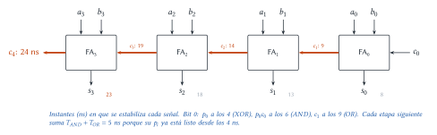
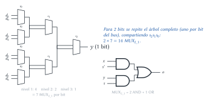
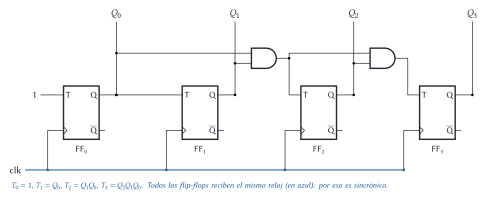
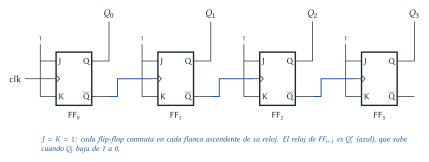

# Diseño Lógico — Recuperatorio 2025 (resuelto)

Cada ejercicio tiene el mismo formato: el **enunciado**, la **idea** para encararlo, la
**resolución** paso a paso y, al final, **dónde está en el apunte** la teoría que se usa.

## Ejercicio 1 — Sumadores y restadores

> **Enunciado.** (1) Tabla de verdad de un restador completo de 1 b. (2) Tabla de verdad de un
> sumador completo de 1 b. (3) Sintetizar un sumador binario de 4 b con compuertas de hasta 2
> entradas, con acarreo _carry-chain_. (4) Costos del sumador: área en compuertas de 2 entradas y
> tiempo, con $T_{AND} = 2$ ns, $T_{OR} = 3$ ns, $T_{XOR} = 4$ ns. (5) Frecuencia de operación.

### 1.1 Restador completo

**Idea.** Calcula una columna de $x - y$ teniendo en cuenta el préstamo $b_{in}$ que pidió la
columna anterior: $x - y - b_{in}$. Si da negativo, se pide prestado 2 a la columna siguiente
($b_{out} = 1$) y la diferencia es lo que queda.

| $x$ | $y$ | $b_{in}$ | $x - y - b_{in}$ | $d$ | $b_{out}$ |
|:---:|:---:|:---:|:---:|:---:|:---:|
| 0 | 0 | 0 | 0 | 0 | 0 |
| 0 | 0 | 1 | −1 | 1 | 1 |
| 0 | 1 | 0 | −1 | 1 | 1 |
| 0 | 1 | 1 | −2 | 0 | 1 |
| 1 | 0 | 0 | 1 | 1 | 0 |
| 1 | 0 | 1 | 0 | 0 | 0 |
| 1 | 1 | 0 | 0 | 0 | 0 |
| 1 | 1 | 1 | −1 | 1 | 1 |

$$d = x \oplus y \oplus b_{in} \qquad b_{out} = x'\,y + x'\,b_{in} + y\,b_{in}$$

### 1.2 Sumador completo

| $x$ | $y$ | $c_{in}$ | $x + y + c_{in}$ | $s$ | $c_{out}$ |
|:---:|:---:|:---:|:---:|:---:|:---:|
| 0 | 0 | 0 | 0 | 0 | 0 |
| 0 | 0 | 1 | 1 | 1 | 0 |
| 0 | 1 | 0 | 1 | 1 | 0 |
| 0 | 1 | 1 | 2 | 0 | 1 |
| 1 | 0 | 0 | 1 | 1 | 0 |
| 1 | 0 | 1 | 2 | 0 | 1 |
| 1 | 1 | 0 | 2 | 0 | 1 |
| 1 | 1 | 1 | 3 | 1 | 1 |

$$s = x \oplus y \oplus c_{in} \qquad c_{out} = x\,y + x\,c_{in} + y\,c_{in}$$

> **Ojo.** La suma/diferencia es la misma XOR en los dos; lo que cambia es el acarreo: el
> sumador "lleva" cuando hay **dos o más unos**, el restador "pide prestado" cuando lo que se
> resta ($y + b_{in}$) es **mayor** que $x$.

### 1.3 Sumador de 4 b con compuertas de 2 entradas (_carry-chain_)

**Idea.** La fórmula $c_{out} = xy + xc_{in} + yc_{in}$ usa compuertas de 3 entradas. Con
compuertas de 2 entradas se usa la forma del apunte (dos semisumadores + OR):

- $p_i = a_i \oplus b_i$ (propagación), $g_i = a_i \cdot b_i$ (generación).
- $s_i = p_i \oplus c_i$
- $c_{i+1} = g_i + p_i \cdot c_i$

Son **5 compuertas de 2 entradas por bit**: 2 XOR, 2 AND, 1 OR. Es equivalente a la fórmula de
mayoría: si $a_i = b_i = 1$ hay acarreo ($g_i$); si exactamente uno vale 1 ($p_i = 1$), el
acarreo de entrada "se propaga".

Se encadenan 4 sumadores completos: el $c_{i+1}$ de cada uno entra como $c_i$ del siguiente
(_carry-chain_ o _ripple carry_), con $c_0 = 0$ (o $c_0$ como entrada).

### 1.4 Costos

**Área.** $4 \text{ bits} \times 5 \text{ compuertas} = 20$: **20 compuertas de 2 entradas** (8 XOR, 8
AND, 4 OR). Si $c_0$ se fija en 0, el bit 0 es un semisumador (1 XOR + 1 AND) y quedan 17.

**Tiempo.** Hay que seguir cuándo se estabiliza cada señal, partiendo de que todas las entradas
están listas en $t = 0$:

1. Todos los $p_i = a_i \oplus b_i$ están a los **4 ns** y todos los $g_i$ a los **2 ns** (se
   calculan en paralelo en todos los bits).
2. Bit 0: $p_0 c_0$ a los $4 + 2 = 6$; $c_1 = g_0 + p_0c_0$ a los $6 + 3 = 9$ **ns**.
3. Bit 1: $p_1$ ya está desde los 4, así que manda $c_1$: $p_1c_1$ a los $9 + 2 = 11$,
   $c_2$ a los $11 + 3 = 14$ **ns**.
4. Cada bit siguiente suma $T_{AND} + T_{OR} = 5$ ns: $c_3$ = **19 ns**, $c_4$ = **24 ns**.
5. Sumas: $s_i = p_i \oplus c_i$ → $s_0 = 8$, $s_1 = 13$, $s_2 = 18$, $s_3 = 23$ ns.

El resultado completo (incluido el acarreo final $c_4$) está estable a los **24 ns**:

$$T = T_{XOR} + n\,(T_{AND} + T_{OR}) = 4 + 4 \cdot 5 = 24 \text{ ns}$$

> **Respuesta.** Área: 20 compuertas de 2 entradas. Tiempo: 24 ns (camino crítico:
> XOR de $p_0$ y luego AND + OR en cada uno de los 4 bits). Sin contar $c_4$, la última suma
> $s_3$ está a los 23 ns.

### 1.5 Frecuencia

> **Respuesta.** Si el sumador opera entre registros, el período mínimo es el tiempo de
> estabilización: $f = \dfrac{1}{24 \text{ ns}} \approx 41{,}7$ MHz. (Si se conocieran los tiempos
> de los registros, se sumarían: $T = t_{prop} + 24 + t_{setup}$.)

> **Dónde está en el apunte.** [Sumadores, restadores y comparadores](../../../apuntes/16-sumadores-restadores-y-comparadores.md):
> §3 sumador completo (con dos semisumadores + OR), §4 _Ripple Carry Adder_ (el tiempo crece con
> $n$), §5.1 restador completo. Camino crítico:
> [Circuitos lógicos combinacionales](../../../apuntes/09-circuitos-logicos-combinacionales.md), §4.

## Ejercicio 2 — Preguntas

> **Enunciado.** (1) Diferenciar circuitos secuenciales y combinacionales. (2) En un circuito
> secuencial, ¿cuándo usar _flip-flops_ y cuándo _latches_? (3) Costo de área en compuertas de 2
> entradas de un $MUX_{8\_2}$, mostrando la implementación. (4) Técnicas de síntesis vistas.

### 2.1 Secuenciales vs. combinacionales

> **Respuesta.** **Combinacional:** la salida depende solo de la combinación actual de entradas
> (misma entrada → misma salida). **Secuencial:** la salida depende de las entradas **y del
> estado** (lo que pasó antes), porque tiene memoria; estructuralmente tiene **realimentación** y
> elementos de memoria (latches/flip-flops).

### 2.2 ¿Flip-flops o latches?

> **Respuesta.** **Flip-flops** cuando el registro forma parte de un lazo, es decir, su próximo
> valor depende de su valor actual ($R = F(R, \dots)$: contadores, acumuladores, registros de
> desplazamiento, banco de registros con ALU): el flip-flop captura una sola vez por flanco. Con un
> latch, durante el nivel activo el valor nuevo vuelve a entrar y da varias vueltas. **Latches**
> cuando no hay realimentación (por ejemplo, retener un dato de entrada o de salida): funcionan
> bien y ocupan la mitad del área.

### 2.3 Área de un $MUX_{8\_2}$

**Idea.** Se construye **jerárquicamente** con $MUX_{2\_1}$ y se cuenta.

- $MUX_{2\_1}$: $o = x\,s' + y\,s$ → **2 AND + 1 OR = 3 compuertas de 2 entradas** (más el inversor
  de $s$, que se comparte entre todos los MUX con la misma selección).
- $MUX_{8\_1}$: árbol de 3 niveles: $4 + 2 + 1 = 7$ $MUX_{2\_1}$.
- $MUX_{8\_2}$ (entradas de 2 bits): un árbol por bit, compartiendo la selección: $2 \times 7 = 14$
  $MUX_{2\_1}$.

$$C_{MUX_{8\_2}} = 14 \cdot C_{MUX_{2\_1}} = 14 \cdot (2\,C_{AND} + C_{OR}) = 28 \text{ AND} + 14 \text{ OR} = 42 \text{ compuertas}$$

> **Respuesta.** 42 compuertas de 2 entradas (28 AND + 14 OR), más 3 inversores para $s_0'$,
> $s_1'$, $s_2'$. Tiempo, por si lo piden: $3\,(T_{AND} + T_{OR})$.

### 2.4 Técnicas de síntesis

> **Respuesta.** AND–OR–INV, multiplexores, PLA, ROM y ROM + MUX (LUT/_slices_ de FPGA). Ver la
> explicación con ejemplos en el Ejercicio 2 del [final del 20/02/2026](final-2026-02-20-resuelto.md).

> **Dónde está en el apunte.** Combinacional vs. secuencial:
> [Circuitos secuenciales](../../../apuntes/17-circuitos-secuenciales-asincronicos-y-sincronicos.md),
> §1. Latch vs. flip-flop: mismo apunte §3 y §7. MUX y costos:
> [Multiplexores y demultiplexores](../../../apuntes/15-multiplexores-y-demultiplexores.md),
> §1.1–1.5. Técnicas: [Implementación](../../../apuntes/10-implementacion.md), §2.

## Ejercicio 3 — Contadores

> **Enunciado.** (1) Contador de 4 b sincrónico con _flip-flop T_. (2) Contador de 4 b
> asincrónico con _flip-flop JK_. (3) Diferencias de funcionamiento entre ambos.

### 3.1 Sincrónico con flip-flops T

**Idea.** Todos con el mismo reloj; cada bit **conmuta cuando todos los bits menos significativos
valen 1**: $T_0 = 1$, $T_1 = Q_0$, $T_2 = Q_1Q_0$, $T_3 = Q_2Q_1Q_0$. (Desarrollo completo en el
[parcial del 03/10/2025](parcial-2025-10-03-resuelto.md), Ejercicio 1.)

### 3.2 Asincrónico con flip-flops JK

**Idea.** Un JK con $J = K = 1$ **conmuta** en cada flanco (se comporta como T con $T = 1$). En el
contador asincrónico cada bit cambia cuando el anterior baja de 1 a 0; con flip-flops de flanco
ascendente eso se logra usando $Q_i'$ como reloj de FF$_{i+1}$.

### 3.3 Diferencias

> **Respuesta.** En el **sincrónico** todos los flip-flops reciben el mismo reloj y cambian en el
> mismo instante; la lógica (AND) decide quién cambia. La salida pasa limpia de un valor al
> siguiente y el retardo no depende de la cantidad de bits, pero ocupa más área. En el
> **asincrónico** cada flip-flop se dispara con la salida del anterior: los cambios se propagan en
> cascada, el último bit se actualiza recién después de $n \cdot t_{prop}$ y aparecen valores
> intermedios falsos (por ejemplo, de 0111 a 1000 pasa por 0110, 0100 y 0000). Es más simple y
> chico, pero más lento para muchos bits y no se puede usar su salida justo después del flanco.

> **Dónde está en el apunte.** [Circuitos contadores](../../../apuntes/19-circuitos-contadores.md),
> §2 (asincrónico), §3 (sincrónico, con la comparación en §3.3). JK y T:
> [Circuitos secuenciales](../../../apuntes/17-circuitos-secuenciales-asincronicos-y-sincronicos.md),
> §5–6.
